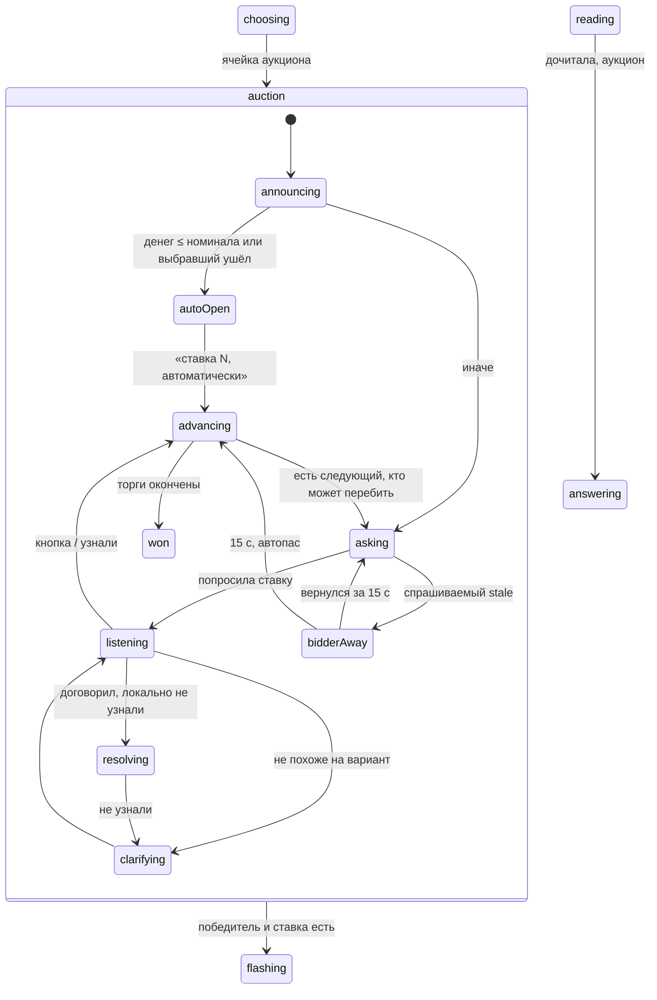

# Аукцион

Статус: **реализован** 13 октября 2026 (ветка `cat-auction`). Код: `src/game/auction.ts`, `prices.ts`, узлы `auction.*` и `specialAway` в `machine.ts`, панель `src/ui/SpecialPanel.tsx`, звук `playAuctionDing`. Тесты: `auction.test.ts`, `special.test.ts`, `specialCues.test.ts`, `SpecialPanel.test.ts`, `specialPick.test.ts`, `e2e/special.play.ts`. В демо — раунд «Особые», ячейка «Торги 200» (v5 `type="auction"`).

Отклонения от плана:

- Клик в конференции — сообщение `specialPick` (`target: auction`, `choice: pass | allIn | число`); мастер сам ищет вариант в своём списке, чужой вариант игнорируется.
- После автоматической ставки номиналом ведущая говорит две фразы (объявление аукциона и итог торгов), а не одну.

Голос: сначала `matchAuctionSpeech`; если не вышло — изолированный вызов `resolveSpecialBid` (в плане `resolveAuctionBid`; один инструмент на ставку кота и аукциона) со списком вариантов экрана. Мастер принимает только вариант из `special.options`, иначе переспрос; таймаут 6 с — переспрос.

Апелляции — как у обычного вопроса, на ставку победителя торгов (±ставка, подтверждение «Да/Нет», окно и в выборе следующего вопроса).

Одна механика «аукцион» для двух обозначений:

- v4 `auction` — 34 вопроса во внешних пакетах, обычное содержимое, без параметров торгов;
- v5 `stake` — 8 вопросов, иногда с картинкой ответа в `param name="answer"`, без параметров торгов.

`stakeAll` (v5, «ставка для всех», 1 вопрос) — **другая механика** (скрытые ставки всех и независимые ответы), в план не входит. Родственный по UI [кот в мешке](CAT.md) уже описывает картинку на табло, локальный звук, выбор кнопкой/голосом и отключение игрока; здесь то же переиспользуется.

## Правила автора

1. Игрок выбирает ячейку аукциона голосом или кликом, как обычную.
2. Мастер переводит машину в фазу аукциона и рассылает её всем. На главном табло у всех схематичная картинка аукциона (`public/images/auction.svg`, молоток с подставкой, без людей) и тема/номинал ячейки. Каждый клиент локально проигрывает «динь-динь-динь» (`public/sounds/auction.wav`), до фразы ведущей.
3. Ведущая свободно: «Поздравляю, у вас вопрос-аукцион» — и просит выбравшего сделать ставку, называя минимум = номинал ячейки.
4. **Первая ставка (выбравший).** Диапазон — от номинала до всех его денег.
   - Денег меньше номинала → ставка = номинал автоматически; ведущая говорит «ставка такая-то, автоматически».
   - Иначе кнопки и голос: номинал ×1, ×2, ×3, ×4 (только ≤ его денег; список — константа `auctionOpenMultipliers = [1, 2, 3, 4]`) и «ва-банк» (все деньги).
5. **Перекупка.** Дальше по кругу следующие игроки. Ведущая: «Будете перекупать?». Варианты: «Пас» или текущая ставка + 1/2/3 номинала (константа `auctionRaiseSteps = [1, 2, 3]`), каждое только ≤ денег игрока, плюс «ва-банк» (все деньги), если это больше текущей ставки.
   - Пример: номинал 40, текущая 80. Деньги 100 → «Пас» или 100 (ва-банк). Деньги 150 → 120, 150 (ва-банк). Деньги 200 → 120, 160, 200 (200 = 80 + 3·40 совпадает с ва-банком — одна кнопка «ва-банк 200»).
   - Игрок, который не может перебить (денег ≤ текущей ставки), не спрашивается — автопас.
   - Перебил → к следующему игроку.
6. **Ва-банк.** Если кто-то пошёл ва-банк, следующий может ответить только своим ва-банком, и только если он больше. Ва-банк бьётся только ва-банком. Пример: ва-банк 100, у игрока 1000 → «Пас» или «ва-банк 1000» (не 140, не 200).
7. Слушают только того, кого спрашивают.

## Сравнение с SIGame

Проверено по [GameController.cs](https://github.com/VladimirKhil/SI/blob/7f8cda975fdd71aef69fa4eef0572d41417d8900/src/SICore/SICore/Clients/Game/GameController.cs) (commit `7f8cda975fdd71aef69fa4eef0572d41417d8900`, `SetAnswererByHighestVisibleStake`, `AskStake`, `TryDetectStakesWinner`, обработка `StakeType`), [ScriptsLibrary.cs](https://github.com/VladimirKhil/SI/blob/7f8cda975fdd71aef69fa4eef0572d41417d8900/src/Common/SIPackages/ScriptsLibrary.cs) (сценарий `stake`: тема/цена → торги → вопрос → ответ одного).

| Правило | SIGame | Наш план |
| --- | --- | --- |
| Кто начинает | Выбравший (`Order[0] = ChooserIndex`) | так же |
| Кто участвует | выбравший всегда; остальные — только если `Sum > nominal` | только с деньгами больше текущей ставки (до первой — больше номинала); остальные автопас |
| Выбравший беден | `Sum < cost` → автоматически номинал; `Sum == cost` и он не беднее всех → тоже номинал | `≤ номинала` (и выбравший ушёл до открытия) → автоматически номинал |
| Шаг ставки | любая сумма, кратная `StakeStep` (наибольшая степень 10 ≤ мин. цены раунда), до всех денег | фиксированные кнопки: ×1–4 на открытии, +1/2/3 номинала на перекупке |
| Пас | навсегда выбывает из этих торгов (`StakeMaking = false`) | так же, пас окончательный |
| Ва-банк | всегда доступен; после ва-банка обычная ставка запрещена (`!AllIn`), участвуют только те, у кого денег больше ставки | так же (правило 6) |
| Кто не может перебить | автопас (`Sum <= Stake`) | так же |
| Конец торгов | остался один участник (`stakerCount == 1`), либо остальные не могут ставить | так же: кругами до одного; перекупленный выбравший снова ходит |
| Отвечает | победитель торгов, один, без кнопки и перехвата; ±ставка | так же; эталон после ошибки; следующим выбирает победитель |

## Данные пакета

- `src/game/siq.ts`: убрать `auction` и `stake` из `specials`. Тело читать как обычное. В `Question` добавить `auction?: { source: 'auction' | 'stake' }`.
- Номинал = `price` вопроса (как сейчас `value`). Цена 0 или отсутствует — решение автора: **минимальная цена раунда** (`roundPriceRange(...).min`, с запасным алгоритмом, если в раунде цен нет; см. «Запасная цена»). Шаг перекупки — этот номинал.
- `stakeAll` остаётся отдельным (сейчас ошибочно обычный — не трогать в этой задаче).
- Аукцион в финальном раунде (`round/@type=final`) — пропуск с предупреждением, как кот.
- Тест `siq.test.ts`: v4 `<type name="auction"/>` и v5 `type="stake"` дают `auction`; `stakeAll` — нет.
- Демо `packs/demo.xml`: один собственный вопрос-аукцион.

## Запасная цена (`src/game/prices.ts`)

Общий модуль для [CAT](CAT.md) и [AUCTION](AUCTION.md). Нужен, когда у вопроса или раунда нет пригодной цены: номинал вопроса 0/пусто/не число, или в раунде нет ни одной цены > 0. Пригодная цена — конечное целое > 0; учитываются **все** вопросы пакета, включая спецвопросы и пропущенные парсером (цены читаются до фильтрации).

Функции (чистые, детерминированные, без случайности):

```ts
roundPriceRange(pack, roundIndex): { min: number; max: number; derived: boolean }
questionNominal(pack, roundIndex, themeIndex, questionIndex): { value: number; derived: boolean }
nicePrice(x: number): number
```

**`roundPriceRange`.** Цены раунда > 0:
- ≥ 1 разная цена → `min`/`max` раунда, `derived: false`. Одна цена (`min == max`) — допустимый результат: у кота это фиксированная цена без ставки (как SIGame), запасной алгоритм **не** включается.
- ни одной → соседние обычные раунды по удалённости: `r−1`, `r+1`, `r−2`, `r+2`, … (при равной дистанции сначала предыдущий); первый раунд с ценами даёт свои `min`/`max`.
- ни в одном раунде → `{ min: 100, max: 500 }` (жёсткий дефолт, `defaultRoundPrices` в `options.ts`). `derived: true` во всех запасных случаях.

**`questionNominal`.** Свой `price` > 0 → он. Иначе по порядку, первое непустое множество цен → медиана:
1. та же позиция (`questionIndex`) в других темах этого раунда;
2. соседи в своей теме: среднее ближайших цен до и после позиции; если с одной стороны нет — экстраполяция по шагу темы (`предыдущая + (предыдущая − пред-предыдущая)`), иначе одна известная соседняя;
3. все цены этого раунда;
4. та же позиция в соседних раундах (порядок, как выше), затем все цены первого соседнего раунда с ценами;
5. все цены пакета;
6. жёсткий дефолт 100.

**Медиана** — для чётного числа нижняя из двух средних (всегда реальное значение пакета). **`nicePrice`** округляет результат шагов 2/4/5: шаг 10 при `x < 200`, 50 при `x < 1000`, 100 дальше; половина — вверх; не меньше шага. Значение, взятое из пакета как есть (свой `price`, медиана реальных цен), остаётся без изменения кроме `nicePrice` для среднего из шага 2.

Где используется:
- кот, `cost` 0/пусто → `roundPriceRange` (две кнопки; при `min == max` — одна фиксированная);
- аукцион, номинал 0/пусто → `roundPriceRange(...).min` (номинал = минимум ставки и шаг перекупки); кот, номинал ячейки 0/пусто → `questionNominal` (только показ);
- предупреждение на старте, если `derived` («цена выведена: 300»), и пометка в debug dump.

Тесты `prices.test.ts`:
- раунд с ценами 100–500 → 100/500; одна цена 200 → 200/200, `derived: false`;
- раунд без цен между раундами 100–500 и 200–1000 → берёт предыдущий (100/500); первый раунд без цен → следующий; пакет без цен → 100/500 и номинал 100;
- номинал 0 на позиции 2 при той же позиции в других темах 300/300/400 → 300; без других тем: соседи 200 и 400 → 300; последняя позиция после 200, 400 → 600; одиночный вопрос в теме → медиана раунда;
- медиана чётного числа (100, 200, 300, 400 → 200); `nicePrice`: 137 → 140, 275 → 300, 1234 → 1200, 3 → 10;
- детерминизм: два вызова на одном пакете — один результат; цены спецвопросов учитываются.

## Варианты ставки: чистая функция

`src/game/auction.ts` (без React и XState), чтобы правила тестировались отдельно:

```ts
type AuctionOption =
  | { kind: 'pass' }
  | { kind: 'stake'; amount: number }
  | { kind: 'allIn'; amount: number }

function auctionOptions(input: {
  nominal: number
  money: number          // счёт игрока
  current: number | null // текущая ставка; null — открытие
  currentAllIn: boolean
  opening: boolean       // ход выбравшего, первый
}): { auto?: number; options: AuctionOption[] }
```

- Открытие: `money <= nominal` (включая ноль и отрицательный счёт) → `{ auto: nominal }`; счёт может уйти глубже в минус. Иначе `nominal × k` для k из `auctionOpenMultipliers`, если `≤ money`; плюс `allIn(money)`; дубль суммы с ва-банком сворачивается в ва-банк. Паса на открытии нет.
- Перекупка, `currentAllIn = false`: `pass`; `current + nominal × k` для `auctionRaiseSteps`, если `≤ money`; `allIn(money)`, если `money > current`. Если ничего кроме паса — игрок не спрашивается (автопас).
- Перекупка, `currentAllIn = true`: `pass` и `allIn(money)` только при `money > current`; иначе автопас.
- Константы — в `src/options.ts` рядом с `matchTimings`.

## Машина (`src/game/machine.ts`)

Новый составной узел `auction` между `choosing` и `flashing`. `QUESTION_SELECTED` обычного раунда с `question.auction` → `auction`.



Контекст: `auctionBid: number | null`, `auctionAllIn: boolean`, `auctionLeaderId`, `auctionBidderId` (кого спрашиваем), `auctionOrder: PlayerId[]` (круг, начиная с выбравшего), `auctionPassed: PlayerId[]`, `auctionOptions: AuctionOption[]`, `auctionLog` (кто что сказал — для табло и истории).

Узлы:

- **auction.announcing.** Вход: `auctionOrder` — круг от `chooserId` по `players`, `auctionBidderId = chooserId`. Статус «Аукцион». Ведущая говорит (`purpose: 'auction'`): поздравление, номинал как минимум, обращение к выбравшему. Микрофон закрыт. Звук «динь» уже сыграл (см. «Звук»).
- **auction.autoOpen.** Ставка = номинал, `auctionLeaderId = chooserId`. Ведущая: «ставка N, автоматически» (`purpose: 'auctionAuto'`; можно слить с announcing одной фразой).
- **auction.asking.** Ведущая просит ставку (`purpose: 'auctionAsk'`): открытие — «назовите ставку, минимум N»; перекупка — «Вася, будете перекупать? Сейчас N у Маши». Варианты в `auctionOptions` уже на экране спрашиваемого, кнопки живые с начала фразы. Бамп `betEpoch`.
- **auction.listening.** Микс модели — только `auctionBidderId` (как `finalBets`). Тишина: как выбор ячейки — без таймера и лимита, подсказки при выключенном микрофоне. Кнопка отправителя ≠ спрашиваемый — отбрасывается.
- **auction.resolving / clarifying.** Разбор голоса локально (см. «Голос»), запасной tool модели — `resolveAuctionBid`. Неясно / не из вариантов → переспрос «назовите один из вариантов», снова `listening`.
- **auction.advancing.** Не ждёт. Применяет ход: ставка → `auctionBid`, `auctionLeaderId`, `auctionAllIn`; пас → `auctionPassed`. Затем ищет следующего по `auctionOrder` после текущего, кто не в `auctionPassed`, не лидер, подключён и у кого `auctionOptions` не пусты кроме паса. Не может перебить — автопас (запись в `auctionLog`, ведущая не обращается). Нет такого → `won`.
- **auction.won.** Ведущая: «Вопрос уходит Васе за N» (`purpose: 'auctionWon'`). `activeStake = auctionBid`, `answeringId = auctionLeaderId` → `flashing`.
- **auction.bidderAway.** Как `cat.recipientAway`: спрашиваемый `stale`, ведущая «Вася отключился, немного подождём», 15 с (`catAwayWaitMs`, общий таймер). Вернулся → `asking`; нет → автопас.

Дальше, как у кота, guard `isAuction`:

- `flashing`/`reading.sealed`: кнопки закрыты, фальстарта нет; `reading.armed` не наступает.
- `reading` + `HOST_AUDIO_FINISHED read` → `answering` с `auctionLeaderId`.
- `answering`/`judging`/`announcing` как обычно, счёт ±`activeStake`, без перехвата, ячейка закрывается после попытки. Эталон публикуется по обычным правилам закрытия.
- Следующим выбирает отвечавший (обычное правило).
- Отключение победителя на ответе — как кот: 15 с, затем 0 очков, ответ на табло, выбирает следующий после него.
- `CHOOSER_OFFLINE` в `auction.announcing` до первой ставки.
- Пауза/restore: `auction.*` в `resumePath`/`RESUME`/`restoring`; `asking`/`listening`/`resolving` → `asking` заново (фраза повторяется, ставки уже в контексте); `advancing`/`won` — без ожидания. `savedGame` хранит новые поля; совместимо с `savedGameVersion: 1`.

## Голос

Решение автора: ставку понимаем в **любой естественной формулировке**, но результат всегда сводится к одному из предложенных `auctionOptions`. Двухступенчато, как выбор ячейки.

1. **Локально** — `matchAuctionSpeech(text, ctx)` в `src/game/auction.ts` (`ctx`: варианты, номинал, текущая ставка, деньги). Нормализация как в `choiceMatch` (регистр, ё→е, знаки). Распознаёт частые формы:
   - пас: «пас», «пасую», «нет», «не буду», «не участвую», «пропускаю», «мимо», «не перекупаю», «без меня» → `pass`;
   - ва-банк: «ва-банк», «ва банк», «всё», «все», «на все», «все деньги», «олл-ин» (уже ловит `parseBet`) → `allIn`;
   - минимум: «номинал», «минимум», «минимальную», «по номиналу» → наименьший вариант-ставка;
   - множители: «удваиваю», «вдвое», «в два раза», «втрое», «в три раза», «вчетверо», «×4» → на открытии номинал × k, на перекупке — текущая ставка × k (принимается, только если это ровно вариант);
   - прибавка: «плюс сто», «+100», «ещё сорок», «поднимаю на 80» → текущая + сумма;
   - сумма: числом или словами через `parseBet(text, money)` («сто двадцать», «120»).
   Найденное значение принимается, только если ровно совпадает с вариантом (`stake`/`allIn`/`pass`); ровно одна интерпретация → готово.
2. **Модель** (реализовано как `resolveSpecialBid`) — изолированный tool `resolveAuctionBid({ turn, choice: 'pass' | 'allIn' | number | 'unclear' })` (`conversation: none`; во входе только транскрипт, номинал, текущая ставка, деньги и список вариантов) — когда локально 0 или >1 интерпретаций или формулировка необычная («давайте-ка рискну всем», «перебью на одну ступеньку»). Принимается только значение из вариантов; иначе — `unclear`.
3. `unclear` или значение не из вариантов → `auction.clarifying` («назовите один из вариантов»), переспрос без лимита; кнопки работают всегда.
4. Подсказка ASR в `auction.listening`: «пас, ва-банк, номинал» и суммы вариантов словами; эхо подсказки — как `ANSWER_ECHO`.

## Конференция

Новых сообщений состояния нет: фаза, `auctionBid`, `auctionAllIn`, `auctionLeaderId`, `auctionBidderId`, `auctionOptions`, `auctionPassed`, `auctionLog` идут `snapshot`/`partialUpdate` ([ONLINE](ONLINE.md)). Клиент → мастер:

- `{ type: 'pick', target: 'auction', choice: 'pass' | 'allIn' | number }` — только от `auctionBidderId`, только значение из `auctionOptions`; мастер пересчитывает варианты сам, клиентским не верит.

`MasterSession`: в `auction.asking/listening` шлёт `AUCTION_BIDDER_OFFLINE/BACK` (по аналогии с котом). Микс модели: только `auctionBidderId`, затем `auctionLeaderId` на ответе — независимо от «Меньше слышать».

## Звук

- Файл `public/sounds/auction.wav`: «динь-динь-динь», CC0, 1,2 с, 53 КБ; источник — [public/sounds/LICENSE.md](../public/sounds/LICENSE.md).
- `playAuctionDing()` в `src/audio/beep.ts` — тот же загрузчик, что `playCatMeow()` из [CAT](CAT.md): `fetch` + `decodeAudioData` один раз, `AudioBufferSourceNode` на `gameAudioContext()`; общий хелпер `playPublicSound(path)`.
- Триггер — вход в `auction.announcing` с новым `question.id`, один раз на вопрос, у всех клиентов; контроллер ждёт `auctionDingMs` (≈1 300 мс) до фразы ведущей.

## UI

- Табло (`GameScreen`), `auction.*`: картинка `public/images/auction.svg` (`${import.meta.env.BASE_URL}images/auction.svg`, перекрашена под тему), тема и номинал ячейки, текущая ставка и лидер крупно («Маша — 120», «Маша — ва-банк 300»), ниже лента `auctionLog` (кто пас/перебил).
- У спрашиваемого — кнопки `auctionOptions` («Пас», «120», «160», «Ва-банк 200»); у остальных тот же экран без кнопок, подпись «Вася решает, перекупать ли». В `ConferencePlayersRow` у пасовавших пометка «пас», у лидера — «ставка».
- После `won` картинку сменяет обычный показ вопроса.
- За столом кнопки на общем экране, микрофон общий.
- Кнопки ответа на всём аукционе закрыты.

## Ведущая и инструменты

- Новые `SpeechPurpose`: `auction`, `auctionAuto`, `auctionAsk`, `auctionClarify`, `auctionWon`, `auctionAway`. Свободная форма (ситуация + цель + ограничения).
- `auction`: «Поздравляю, у вас вопрос-аукцион», номинал как минимальная ставка, обращение по имени.
- `auctionAsk`: имя, текущая ставка и лидер, «Будете перекупать?». Варианты не перечислять целиком (они на экране).
- `auctionWon`: кому и за сколько. Объявление результата называет ставку, не номинал.
- Tool `resolveAuctionBid` (в коде — `resolveSpecialBid`) — см. «Голос».

## Тесты

- `auction.test.ts`: `auctionOptions` — все примеры автора (40/80 при 100/150/200), открытие ×1–4 и обрезка по деньгам, `money < nominal` → auto, `money == nominal`, ва-банк после ва-банка, дубль суммы с ва-банком, отрицательный счёт; `matchAuctionSpeech` — «пас», «ва-банк», «сто двадцать», «120», промежуточная сумма, «удваиваю».
- `prices.test.ts`: см. «Запасная цена»; аукцион с ценой 0 получает выведенный номинал.
- `siq.test.ts`: `auction`/`stake` → аукцион; `stakeAll` нет.
- `machine.test.ts`: 1/2/3 игрока; автопас; ва-банк; конец торгов; победитель отвечает без кнопки ±ставка; нет перехвата; следующий выбирающий; restore/pause в каждом узле; уход спрашиваемого.
- `controller.test.ts`: purposes, `betEpoch`, микс только спрашиваемого.
- `masterSession.test.ts`/`messages.test.ts`: `pick target=auction` от чужого клиента и не из вариантов отвергается.
- `beep.test.ts`: `playAuctionDing`; e2e: `match.play.ts` (мок) — аукцион демо; `conference.play.ts` — перекупка кнопкой.

## Решения

Все вопросы закрыты автором 13 октября 2026:

1. Торги идут кругами, пока не останется один участник; пас — окончательный.
2. Перекупленный выбравший снова получает ход, правила перекупки те же (+1/2/3 номинала, ва-банк).
3. Участвуют только те, у кого денег больше текущей ставки; остальные — автопас.
4. Выбравший на открытии спасовать не может.
5. Равные ва-банки: второй перебить не может, выигрывает первый.
6. Победитель отвечает один, без кнопки и перехвата, ±ставка; после ошибки эталон показывается.
7. Тишина — переспрос без лимита, кнопки работают всегда.
8. Следующую ячейку выбирает победитель торгов.
9. Спрашиваемый отключился — 15 с, затем автопас; победитель отключился на ответе — правила кота (0 очков, эталон, выбирает следующий после него).
10. Выбравший ушёл до открытия — автоматически номинал.
11. Денег ровно номинал — автоматически номинал.
12. Цена вопроса 0/нет — минимальная цена раунда (с запасным алгоритмом).
13. Сумма не из вариантов — переспрос.
14. Голос понимает ставки гибко (см. «Голос»): локальный разбор + `resolveAuctionBid`, результат — только вариант.
15. Автопас — только пометка на экране, вслух не называется.
16. Один игрок: ставка открытия и сразу вопрос.
17. Больше никто не может торговаться — сразу к выбравшему, одна фраза ведущей («ставка N, автоматически, вопрос ваш»).
18. Ведущая варианты не перечисляет: «Сейчас 80 у Маши, перекупаете?».
19. Отрицательный счёт — автоматически номинал, можно уйти глубже в минус.
20. «За столом» — спрашиваемый определяется по очереди, общий микрофон.
21. Аукцион в финальном раунде — пропуск с предупреждением.
22. Медиа ответа v5 `stake` — по обычным правилам раскрытия.
