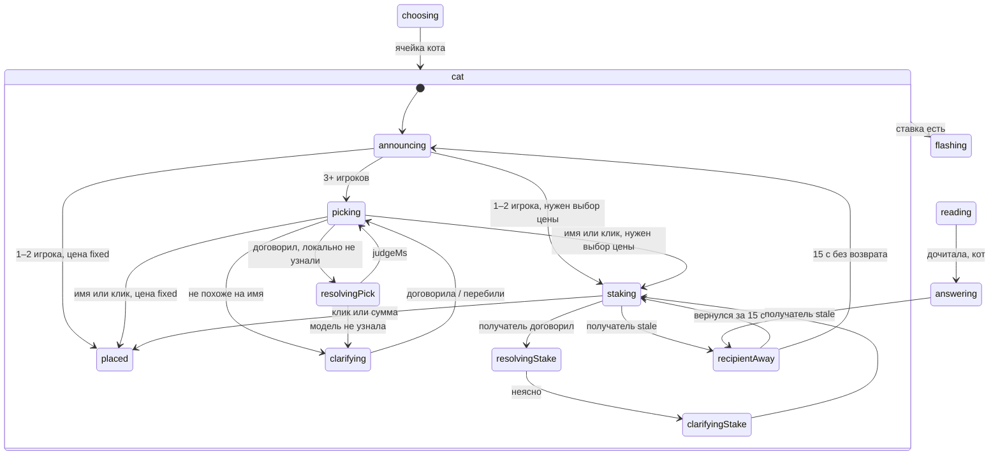

# Кот в мешке

Статус: **реализован** 13 октября 2026 (ветка `cat-auction`). Код: `src/game/cat.ts`, `prices.ts`, `nameMatch.ts`, узлы `cat.*` и `specialAway` в `machine.ts`, панель `src/ui/SpecialPanel.tsx`, звук `playCatMeow` в `src/audio/beep.ts`. Тесты: `cat.test.ts`, `prices.test.ts`, `special.test.ts`, `specialCues.test.ts`, `siq.test.ts`, `SpecialPanel.test.ts`, `specialPick.test.ts`, `e2e/special.play.ts`. В демо — раунд «Особые», «Сюрприз 200» (`cat`, цена мин/макс раунда) и «Сюрприз 300» (`bagcat`, `knows=before`, `[100;300]`).

Отклонения от плана:

- Клик в конференции идёт новым сообщением `specialPick` (`target: player | stake`), а не расширением `pick`; кнопки «кому отдать» — на панели кота, а не клик по карточке игрока.
- Автополучатель при двух игроках выбирается из всех игроков ростера, не только подключённых (отключённого ловит общее ожидание 15 с).
- Передача права отдать при уходе дарителя возвращает в `cat.announcing` без отдельной фразы.

Голос — как выбор ячейки (`choosing`, `choicePrompt.ts`): на `cat.picking` подсказка распознаванию — имена кандидатов без выбравшего (`playersPrompt`, `{Анна; Вера}`, предел 1024), на `cat.staking.listening` — `{минимум 100 сто; максимум 300 триста}` (`optionsPrompt`). Реплика проходит те же фильтры: `echoesChoicePrompt` (эхо подсказки), `choiceGate` (шум), эпоха узла. Затем локальный разбор (`matchSpokenPlayer`, `matchCatStake`); не вышло — узел `cat.resolving` / `cat.staking.resolving`, изолированный (`conversation: none`) вызов `selectCatRecipient` (транскрипт + «id: имя» кандидатов) или `resolveSpecialBid` (варианты экрана). Принимается только кандидат/вариант из списка при `confident=true`, иначе `clarifying`; модель молчит `judgeMs` — снова слушаем, как в выборе ячейки.

Апелляции — как у обычного вопроса (e332f20), сумма — ставка получателя: минус ставки → кнопка «Апелляция» сразу; так как ячейка после ответа получателя закрыта и эталон объявлен, это всегда подтверждение «Да, я ответил правильно» / «Нет, не надо апелляцию», без переответа; «Да» меняет −ставку на +ставку. Ставка хранится в `outcomes[q][p].stake`.

Один механизм «кот в мешке» обслуживает оба обозначения старого формата:

- v4 `cat` — 39 вопросов во внешних пакетах; в `type` есть `theme` и `cost` (бывают пустая тема и `cost=0`).
- v4 `bagcat` — 6 вопросов (`muzykalny_pak.siq`, все со звуком `voice`); в `type` есть `theme`, `cost`, `self=true`, `knows=before/after/never`.
- В SIGame v5 это `secret` (= `cat` и `bagcat knows=after`), `secretPublicPrice` (`knows=before`), `secretNoQuestion` (`knows=never`), с параметрами `selectionMode`, `theme`, `price/numberSet`. Эти v5-типы в план **не входят** — отдельная задача; модель данных ниже позволяет подключить их без новой механики.

## Согласованные правила

1. Игрок выбирает ячейку кота голосом или кликом, как обычную.
2. Мастер переводит машину в новую фазу и рассылает её всем. Каждый клиент по этой смене состояния локально проигрывает «мяу» (файл `public/sounds/meow.wav`), не через конференцию. Мяу звучит до фразы ведущей.
3. На главном табло у всех клиентов вместо вопроса — схематичная картинка кота (`public/images/cat.svg`), пока ведущая объявляет кота и спрашивает, кому отдать. Ведущая своими словами объявляет кота: «Поздравляю, у вас кот в мешке, вопрос нужно отдать». Говорит это всегда, даже при одном или двух игроках.
4. Получатель. **Оставить кота себе нельзя никогда**, как в телеигре; `self=true` из пакета игнорируется. Единственное исключение — один игрок: вопрос автоматически достаётся ему. Отдать кота отключённому (`stale`) игроку нельзя.
   - 1 игрок — он сам;
   - 2 игрока — автоматически второй;
   - 3 и больше подключённых кандидатов — ведущая спрашивает «Кому отдадите?» и слушает **только** выбравшего. Он называет имя голосом (в любой форме: «Матвею», «Маше», «Васе») или кликает карточку игрока в ряду участников. Клик доступен всегда, как клик по ячейке.
5. Нераспознанное имя (тишина, шум, неизвестный игрок, сам выбравший) обрабатывается **так же, как нераспознанный выбор ячейки** (см. «Выбор получателя»).
6. Ход переходит к получателю. Ведущая называет тему кота, и у всех на табло тема заменяет картинку кота (пустая — тема ячейки) и, если цена не фиксирована, просит ставку: **только минимум или максимум** (см. «Ставка»). На главном экране получателя тема и две кнопки; он кликает, называет сумму («сто», «500») или говорит «минимум»/«максимум». Слушают только его. Ставка разрешена при любом счёте.
7. Ведущая читает вопрос. Получатель отвечает **без кнопки**, как будто он её нажал. Дальше как обычно: окно ответа, сигналы, оценка, +ставка за верный, −ставка за неверный.
8. **Следующую ячейку выбирает получатель** — при любом исходе ответа.
9. Получатель отключился во время ставки или ответа: ведущая говорит, что игрок отключился и мы немного подождём; ждём 15 секунд. Вернулся — продолжаем. Нет — идём дальше: ячейка закрывается, очки не меняются (0 в обоих случаях), ответ пакета показывается, выбирает следующий по кругу после получателя (см. «Отключение получателя»).
10. Кот в финальном раунде и `knows=never` пока пропускаются с предупреждением на старте. За столом имя и ставку слушаем с общего микрофона.
11. Апелляции — как у обычного вопроса, на ставку (добавлено по просьбе автора 13 октября 2026, см. начало документа).

## Данные пакета

Сейчас `src/game/siq.ts` берёт тип через `questionKind()` и пропускает всё из `specials` (`cat`, `auction`, `bag`, `sponsored`, `secret`, `stake`, `marker`). `bagcat` в `specials` нет, поэтому он читается как обычный с ценой ячейки.

Изменения парсера:

- Убрать `cat` из `specials`; `cat` и `bagcat` читать как обычное тело (текст/медиа/ответы/marker) плюс поле `cat`.
- Читать `type/param` по имени: `theme`, `cost`, `knows` (регистр игнорировать). `self` читать только в debug/предупреждение: на правила не влияет.
- В `Question` (`src/game/types.ts`) добавить необязательное:

```ts
cat?: {
  source: 'cat' | 'bagcat'
  theme: string        // пусто → themeName ячейки
  price: CatPrice      // разобранный cost, см. «Ставка»
  knows: 'before' | 'after' | 'never' // cat: 'after'
}
type CatPrice =
  | { kind: 'fixed'; value: number }                       // "300"
  | { kind: 'range'; min: number; max: number; step: number } // "[100;500]/100"
  | { kind: 'roundMinMax' }                                // "0", пусто, мусор
```

- `knows=never` и кот в `round/@type=final` пока пропускаются с предупреждением на старте. Пустой текст без медиа — как сейчас.
- Тест `siq.test.ts`: v4 XML с `cat` (число, пустая тема, `cost=0`, пустой `cost`) и `bagcat` (`self=true`, все три `knows`, диапазон); `bagcat` больше не обычный вопрос.
- В демо `packs/demo.xml` — один собственный вопрос `cat` (без чужих текстов), пересобрать `npm run packs`.

### Ставка (по SIGame)

Решение: **повторяем SIGame.** Проверено по commit `7f8cda975fdd71aef69fa4eef0572d41417d8900`:

- [Question.cs](https://github.com/VladimirKhil/SI/blob/7f8cda975fdd71aef69fa4eef0572d41417d8900/src/Common/SIPackages/Question.cs) (`case BagCat/Cat`): `cost` из `type` превращается в `NumberSet` через `NumberSetTypeConverter`; `knows` выбирает тип `secret` / `secretPublicPrice` / `secretNoQuestion`; `self=true` даёт `selectionMode=any`, иначе `exceptCurrent`.
- [NumberSetTypeConverter.cs](https://github.com/VladimirKhil/SI/blob/7f8cda975fdd71aef69fa4eef0572d41417d8900/src/Common/SIPackages/TypeConverters/NumberSetTypeConverter.cs): одно число `"300"` → `[300;300]`; `"[min;max]/step"` → диапазон; пустое или нераспознанное → пустой `NumberSet` (0;0).
- [GameController.cs](https://github.com/VladimirKhil/SI/blob/7f8cda975fdd71aef69fa4eef0572d41417d8900/src/SICore/SICore/Clients/Game/GameController.cs) `OnSelectPrice`:
  - `Maximum == 0` (то есть `cost` 0/пусто): если минимальная и максимальная цена раунда равны — цена ставится сама; иначе игрок выбирает из `StakeRange(min, max, step = max − min)`, то есть **ровно два варианта: минимум или максимум раунда**. Минимум считается только по ценам > 0.
  - `Minimum == Maximum` (одно число в `cost`): цена **фиксирована**, выбора нет, сразу дальше.
  - иначе: выбор из диапазона пакета с его шагом.
- `OnAnnouncePrice` (шаг `knows=before`/всегда перед выбором) лишь объявляет цену или диапазон.

У нас:

- `fixed` (`cost > 0`) — ставки нет: ведущая называет тему и цену («вопрос за 300») и сразу читает. Узел `cat.staking` пропускается. Это и соответствует SIGame, и покрывает большинство `cat` с ценой.
- `roundMinMax` — две кнопки: минимум и максимум номиналов текущего раунда (по всем вопросам раунда > 0, включая сыгранные — как `_minRoundPrice/_maxRoundPrice`, которые SIGame считает при старте раунда), через `roundPriceRange` (см. «Запасная цена»). Если они равны (в раунде одна цена) — как `fixed`, одна цена без ставки, по SIGame. Если в раунде цен нет вовсе — запасной алгоритм.
- Номинал самой ячейки кота 0/пусто — `questionNominal` (важно для показа и предупреждения; очки всё равно меняет ставка).
- `range` — тоже две кнопки: `min` и `max` диапазона пакета (решение автора; промежуточные значения не предлагаются). В наших пакетах формат пока не встречен.
- Голосом — **только минимум или максимум**: сумма («сто», «500», через `parseBet` из `src/game/bet.ts`), равная одному из двух вариантов, или слова «минимум/минимальн…/меньш…» и «максимум/максимальн…/больш…». Любое другое значение — нераспознано, переспрос без лимита, как ячейка; кнопки работают всегда.
- Ограничений по счёту нет: любую из двух ставок можно выбрать при любом (в том числе отрицательном) счёте.

## Запасная цена (`src/game/prices.ts`)

Общий модуль для [CAT](CAT.md) и [AUCTION](AUCTION.md). Нужен, когда у вопроса или раунда нет пригодной цены: номинал вопроса 0/пусто/не число, или в раунде нет ни одной цены > 0. Пригодная цена — конечное целое > 0; учитываются **все** вопросы пакета, включая спецвопросы и пропущенные парсером (цены читаются до фильтрации).

Функции (чистые, детерминированные, без случайности):

```ts
roundPriceRange(pack, roundIndex): { min: number; max: number; derived: boolean }
questionNominal(pack, roundIndex, themeIndex, questionIndex): { value: number; derived: boolean }
nicePrice(x: number): number
```

**`roundPriceRange`.** Цены раунда > 0:
- ≥ 1 разная цена → `min`/`max` раунда, `derived: false`. Одна цена (`min == max`) — допустимый результат: у кота это фиксированная цена без ставки (как SIGame), запасной алгоритм **не** включается.
- ни одной → соседние обычные раунды по удалённости: `r−1`, `r+1`, `r−2`, `r+2`, … (при равной дистанции сначала предыдущий); первый раунд с ценами даёт свои `min`/`max`.
- ни в одном раунде → `{ min: 100, max: 500 }` (жёсткий дефолт, `defaultRoundPrices` в `options.ts`). `derived: true` во всех запасных случаях.

**`questionNominal`.** Свой `price` > 0 → он. Иначе по порядку, первое непустое множество цен → медиана:
1. та же позиция (`questionIndex`) в других темах этого раунда;
2. соседи в своей теме: среднее ближайших цен до и после позиции; если с одной стороны нет — экстраполяция по шагу темы (`предыдущая + (предыдущая − пред-предыдущая)`), иначе одна известная соседняя;
3. все цены этого раунда;
4. та же позиция в соседних раундах (порядок, как выше), затем все цены первого соседнего раунда с ценами;
5. все цены пакета;
6. жёсткий дефолт 100.

**Медиана** — для чётного числа нижняя из двух средних (всегда реальное значение пакета). **`nicePrice`** округляет результат шагов 2/4/5: шаг 10 при `x < 200`, 50 при `x < 1000`, 100 дальше; половина — вверх; не меньше шага. Значение, взятое из пакета как есть (свой `price`, медиана реальных цен), остаётся без изменения кроме `nicePrice` для среднего из шага 2.

Где используется:
- кот, `cost` 0/пусто → `roundPriceRange` (две кнопки; при `min == max` — одна фиксированная);
- аукцион и кот, номинал ячейки 0/пусто → `questionNominal` (номинал = минимум ставки аукциона и шаг перекупки);
- предупреждение на старте, если `derived` («цена выведена: 300»), и пометка в debug dump.

Тесты `prices.test.ts`:
- раунд с ценами 100–500 → 100/500; одна цена 200 → 200/200, `derived: false`;
- раунд без цен между раундами 100–500 и 200–1000 → берёт предыдущий (100/500); первый раунд без цен → следующий; пакет без цен → 100/500 и номинал 100;
- номинал 0 на позиции 2 при той же позиции в других темах 300/300/400 → 300; без других тем: соседи 200 и 400 → 300; последняя позиция после 200, 400 → 600; одиночный вопрос в теме → медиана раунда;
- медиана чётного числа (100, 200, 300, 400 → 200); `nicePrice`: 137 → 140, 275 → 300, 1234 → 1200, 3 → 10;
- детерминизм: два вызова на одном пакете — один результат; цены спецвопросов учитываются.

## Выбор получателя

### Как сейчас работает нераспознанный выбор ячейки

Из `controller.ts` (`handleChoiceSpeech`) и STATES, пункты 29–40:

- Короткий звук (`choiceGate` → `ignore`) — ничего: trace-заметка, остаёмся в `choosing.listening`.
- Реплика не похожа на выбор (`ask-again`) — «Оценка»: «Услышала: …, нужны тема и стоимость», `QUESTION_UNCLEAR` → `choosing.clarifying`: ведущая говорит причину («Не расслышала тему и стоимость. Повторите, пожалуйста.»), микрофон открыт; её речь игрок может перебить; `HOST_AUDIO_FINISHED clarify` → снова `listening`.
- Локальное совпадение `matchSpokenCell` — сразу `QUESTION_SELECTED`. Иначе ход модели `selectQuestion` (`choosing.resolving`, `conversation: none`); отказ → `QUESTION_UNCLEAR` с «Я не уверена…» или «Этот вопрос недоступен…»; нет ответа за `judgeMs` → `listening` со статусом «Не удалось разобрать выбор».
- Тишину таймер не ловит: `choosing.listening` ждёт бесконечно, лимита повторов нет. В конференции при выключенном микрофоне — подсказки через 3 с и каждые 5 с. Клик по ячейке работает в любом детёныше `choosing`.

### Как будет у кота (3+ игроков)

Тот же поток, свои узлы и тексты:

- `cat.picking` = `listening`: ждёт без таймера, mic-подсказки те же, ведущая своими словами спрашивает, кому отдаёт.
- шум → игнор; не похоже на имя / ни одного совпадения / несколько совпадений / сам выбравший → «Оценка»: «Услышала: …, нужно имя игрока» и `CAT_PICK_UNCLEAR` → `cat.clarifying` («Не расслышала, кому отдаёте. Назовите имя ещё раз» — свободно; для самого себя — «себе оставить нельзя»), затем снова `picking`.
- `cat.resolvingPick` — ход модели, только если локальное сопоставление не дало ответа; `judgeMs` → `picking`.
- Клик по карточке допустим в любом `cat.picking/clarifying/resolvingPick` и сразу назначает получателя (поздний ответ модели отбрасывается по `choiceEpoch`).

### Сопоставление имён

В коде сейчас сопоставления имён нет: `matchSpokenCell` (`choiceMatch.ts`) ищет только темы и цены, `players.ts` лишь разбирает поле имён, модель имена игроков не сопоставляет. Предложение — двухступенчатое, как у ячеек:

1. **Локально** (`src/game/nameMatch.ts`, `matchSpokenPlayer(transcript, candidates)`): нормализация как в `choiceMatch` (регистр, ё→е, знаки). Для каждого слова реплики и имени — основа: отрезать одно окончание из списка падежных `ой|ей|ом|ем|ам|ям|ах|ях|у|ю|е|и|ы|а|я|ь|й` (длинные первыми), оставляя ≥ 2 букв. Совпадение, если основы равны или одна — префикс другой длиной ≥ 3 («матве-» из «Матвею» и «Матвей», «маш-» из «Маше» и «Маша», «вас-» из «Васе»/«Вася»). Имена из нескольких слов — хватает любого слова с уникальным совпадением. Ровно один кандидат → получатель; иначе null. Дефолтные «Игрок 2» — по цифре/слову («второму»).
2. **Модель** (`selectCatRecipient({ turn, playerId } | { turn, unclear: true })`, изолированный ход `conversation: none`, только транскрипт + список `id: имя` без выбравшего) — когда локально 0 или >1 кандидатов. Она понимает уменьшительные («Мотя» → «Матвей», «Машеньке» → «Мария»), которые стеммингом не взять. Принимается только `playerId` из кандидатов.
3. Подсказка ASR в `cat.picking`: имена кандидатов в нескольких падежах («Матвей, Матвею, Маша, Маше…»), как словарь редких слов; эхо этой подсказки фильтруется как `ANSWER_ECHO`.

Вопрос ведущей — своими словами «кому отдаёте кота» (готовой цитаты в подсказке нет).

## Машина (`src/game/machine.ts`)

Новый составной узел `cat` между `choosing` и `reading`. `QUESTION_SELECTED` обычного раунда с `question.cat` идёт в `cat`, а не в `flashing`.



Контекст: `catGiverId`, `catRecipientId`, `catStakeOptions: number[]`, `catStake`, `catAwayFrom` (`'staking' | 'answering'`). Очки меняет `activeStake` (как финал), не `value`.

Узлы:

- **cat.announcing.** Вход: `catGiverId = chooserId`; 1 игрок → получатель он же, 2 → другой. Статус «Кот в мешке». Ведущая говорит (`purpose: 'cat'`; `hostCue`: имя выбравшего, число игроков, известный получатель; при `knows=before` тема и цена). Микрофон закрыт. `HOST_AUDIO_FINISHED cat` → `picking` / `staking` / `placed`.
- **cat.picking / clarifying / resolvingPick.** См. «Выбор получателя». Микс модели — только выбравший; `pick` от других отвергается. Кандидаты — подключённые игроки, кроме выбравшего; `stale` не кандидат (карточка неактивна, имя такого игрока — нераспознано с пояснением, что он не в сети). Если подключённых кандидатов нет (все остальные `stale`), ячейка закрывается так же, как после неуспешного ожидания получателя (0 очков, ответ на табло). При ровно одном подключённом кандидате он назначается автоматически, как при двух игроках.
- **cat.staking.** `chooserId` для подсветки и подписи — получатель («Вася делает ставку»). Ведущая называет тему и варианты (`purpose: 'catStake'`), затем слушает только получателя. Тишину таймер не ловит, как в `picking`; при выключенном микрофоне — те же подсказки; кнопки работают всегда.
- **cat.resolvingStake / clarifyingStake.** Локальный `parseBet` + проверка варианта; неясно → переспрос, без лимита, как ячейка.
- **cat.placed.** Не ждёт: `activeStake = catStake`, `answeringId = catRecipientId` → `flashing`. Для `fixed` ведущая называет цену в фразе `catStake`-подобной перед чтением (одна фраза «тема, цена» без ожидания).
- **cat.recipientAway.** См. ниже.

Дальше обычный путь с guard `isCat`:

- `flashing`/`reading.sealed`: кнопки закрыты, фальстарта нет (как финал); `reading.armed` не наступает.
- `reading` + `HOST_AUDIO_FINISHED read` → `answering` с `catRecipientId`, без отдельной фразы хода.
- `answering`/`judging`/`announcing` — как обычно, счёт ±`activeStake`. Перехвата нет: после `incorrect`/`silence` ячейка закрывается (ветка 71 не срабатывает), ответ пакета публикуется по обычным правилам закрытия. `near_miss` → повтор тому же игроку.
- После объявления `chooserId = catRecipientId` при любом исходе (сейчас и так выбирает последний оцененный/промолчавший — совпадает).
- Пауза/восстановление: `cat.*` в `resumePath`/`RESUME`/`restoring`; `picking`/`staking` — заново с фразы, `resolving*` — в соответствующий слушающий узел, `recipientAway` — заново полные 15 с. `savedGame` сохраняет новые поля; совместимо с `savedGameVersion: 1`.
- Эпохи: `cat.picking` и `cat.staking` бампят `choiceEpoch`/`betEpoch`.
- `CHOOSER_OFFLINE` в `cat.announcing/picking*` (ушёл выбравший): право отдать кота переходит следующему по кругу подключённому игроку (`catGiverId` меняется, ведущая свободно объявляет); отдать себе он тоже не может.

### Отключение получателя

Только конференция. Сейчас presence даёт `stale` через `PRESENCE_STALE_MS` (10 с без heartbeat) и в `answering.*` машине ничего не шлёт. Добавить: `MasterSession` в `cat.staking*` и в `answering.*`/`judging` кота шлёт `CAT_RECIPIENT_OFFLINE` (и `CAT_RECIPIENT_BACK` при возврате).

- Переход в `cat.recipientAway` (запомнить `catAwayFrom`). Ведущая свободно: «Вася отключился, немного подождём» (`purpose: 'catAway'`). Таймер `catAwayWaitMs = 15 000` в `options.ts`, полоска на табло видна. Таймеры ответа/оценки остановлены; незавершённая попытка ответа отменяется (`attemptId` бампится, поздняя оценка отбрасывается).
- `CAT_RECIPIENT_BACK` за 15 с → назад: в `staking` — заново фраза ставки; из ответа — в `answering.waiting` с полным `answerMs` (вопрос заново не читается). Очки не меняются.
- 15 с вышло → `announcing`, повод новый `away`: очки 0, ячейка в `playedIds`, ответ пакета **публикуется** на табло и вслух, как при `nobody`, ведущая коротко говорит, что идём дальше и кто выбирает. `chooserId` = **следующий по кругу присутствующий игрок после получателя** (тот же выбор, что у `CHOOSER_OFFLINE`, `MasterSession`). Затем обычные переходы 72–74 (`choosing`/`bridging`/`finished`).
- 15 с отсчитываются от момента `stale` (то есть ≈25 с от последнего heartbeat).

## Конференция

Новых типов сообщений состояния нет: фаза, `catGiverId`, `catRecipientId`, `catStakeOptions`, `catStake`, тема кота и полоска ожидания идут обычным `snapshot`/`partialUpdate` ([ONLINE](ONLINE.md)). Клиент → мастер:

- `pick` расширить: `{ type: 'pick', target: 'player', playerId }` в `cat.picking*` — только от `catGiverId`, не сам себя (при 1 игроке узла нет);
- `{ type: 'pick', target: 'stake', amount }` в `cat.staking*` — только от `catRecipientId`, сумма из `catStakeOptions`.

Валидация в `messages.ts` (`isConferenceMessage`) и `masterSession` — как у существующего `pick`. Микс модели (`audioMix`): `cat.picking*` → выбравший, `cat.staking*`/`answering` → получатель, независимо от «Меньше слышать» (как `finalBets`).

## Звук «мяу»

- Файл `public/sounds/meow.wav`: одно мяу, public domain (Wikimedia Commons, «Meow of a pleading cat», автор Heismark), моно 22 050 Гц, 1,05 с, 46 КБ, нормализован. Источник и обработка — [public/sounds/LICENSE.md](../public/sounds/LICENSE.md). Синтез не используется.
- Воспроизведение — как сигнал таймаута, локально через Web Audio: `playCatMeow()` в `src/audio/beep.ts` один раз `fetch` + `decodeAudioData` файла (`${import.meta.env.BASE_URL}sounds/meow.wav`, как `publicFile` в `HostPresence`), кеширует `AudioBuffer` и играет `AudioBufferSourceNode` на `gameAudioContext()` (контекст уже разблокирован `unlockAudio`). Предзагрузка при старте партии. Если декодирование не удалось — тихо пропустить.
- Триггер: эффект в `GameScreen` на вход в `cat.announcing` с новым `question.id`, один раз на вопрос (не на каждый диф и не при reload/restore). Одинаково у мастера, joiner и за столом. Модели звук не передаётся.
- Порядок: мяу до фразы ведущей. Контроллер на входе в `cat.announcing` выдерживает `catMeowMs` (≈1 100 мс, `options.ts`) и только потом даёт реплику `cat` (как `timeoutBeepMs` перед объявлением молчания).

## UI

- Табло (`GameScreen`): в `cat.announcing` и `cat.picking*` — крупно картинка `public/images/cat.svg` (`${import.meta.env.BASE_URL}images/cat.svg`, как `publicFile` в `HostPresence`) и подпись «Кот в мешке» (+ тема и цена при `knows=before`). Как только получатель назначен (имя, клик или автоматически при 1–2 игроках, то есть с фразы `catStake`), картинку у всех заменяет тема кота (и цена/варианты ставки); дальше обычный показ вопроса. Источник и лицензия картинки — [public/sounds/LICENSE.md](../public/sounds/LICENSE.md).
- `cat.picking*`: в `ConferencePlayersRow` и в ряду стола карточки других игроков кликабельны для выбравшего («Кому отдадите?»); своя карточка неактивна. Остальные видят «Вася отдаёт вопрос». За столом клик — с общего экрана.
- `cat.staking*`: у получателя тема и кнопки ставок; у остальных тот же экран без кнопок, «Вася делает ставку». За столом кнопки на общем экране.
- `cat.recipientAway`: «Ждём Васю» и полоска 15 с у всех.
- Кнопки ответа на всём коте закрыты.

## Ведущая и инструменты (`controller.ts`, `src/realtime/tools.ts`)

- Новые `SpeechPurpose`: `cat`, `catClarify`, `catStake`, `catStakeClarify`, `catAway`. Все свободные: ситуация + цель + ограничения.
- `cat`: поздравить с котом, вопрос нужно отдать; при 1 — что остаётся у игрока; при 2 — кому уходит; при 3+ — спросить, кому отдаёт (своими словами). При `knows=after` тему не называть.
- `catStake`: получатель, тема кота, варианты ставки или фиксированная цена.
- Tool `selectCatRecipient` — см. «Сопоставление имён». Ставка — локально, запасной `resolveSpecialBid`.
- Объявление результата называет ставку, а не номинал ячейки.

## Тесты

- `prices.test.ts`: см. «Запасная цена».
- `siq.test.ts`: `cat`/`bagcat`, все виды `cost`, пустая тема, `knows`, `self` игнорируется.
- `nameMatch.test.ts`: «Матвею/Маше/Васе/Игроку 2/второму», неоднозначность, два одинаковых имени, сам выбравший, `stale` игрок.
- ставка кота: «сто», «500», «минимум», «максимум», промежуточная сумма диапазона — нераспознано.
- `machine.test.ts`: 1/2/3 игрока; picking голосом и кликом; unclear → clarifying → picking; запрет себе; ставка fixed/roundMinMax/равные min=max; верно/неверно ±ставка, закрытие без перехвата; следующий выбирает получатель; `recipientAway` вернулся/не вернулся (0 очков, chooser следующий); пауза/RESUME/restore в каждом `cat.*`; `NEXT_ROUND`.
- `controller.test.ts`: purposes, эпохи, микс; `masterSession.test.ts`: `CAT_RECIPIENT_OFFLINE/BACK`, `pick` от чужого клиента.
- `beep.test.ts` (`playCatMeow`: загрузка, кеш буфера, тихий сбой декодирования); проверка, что `public/sounds/meow.wav` и `public/images/cat.svg` есть в сборке, `ConferencePlayersRow.test.ts` (кликабельность).
- e2e: `match.play.ts` (мок) — кот демо-пакета; `conference.play.ts` — передача кликом карточки.

## Решения по открытым вопросам

Все вопросы первой версии плана закрыты автором 13 октября 2026:

- Следующую ячейку выбирает получатель.
- `self=true` игнорируется: себе нельзя, кроме единственного игрока; отключённому отдать нельзя.
- Нераспознанное или неизвестное имя, тишина на выборе и на ставке — как нераспознанная ячейка, без лимита повторов; клик работает всегда.
- Имена узнаются в любом падеже (локальная основа + запасной tool модели).
- Нет пригодных цен в раунде/ячейке — детерминированный запасной алгоритм (соседние темы, раунды, пакет, дефолт 100/100–500).
- Цена — по SIGame: число — фиксированная, без ставки; 0/пусто — минимум/максимум раунда; диапазон — минимум/максимум диапазона. Голосом только эти два значения. Любая ставка при любом счёте.
- Пустая тема кота — тема ячейки. `knows=never` и кот в финале — пропуск с предупреждением. v5 `secret*` — отдельная задача.
- Ушёл выбравший — право отдать переходит следующему по кругу. Ушёл получатель — 15 с от `stale`; вернулся на ответе — окно ответа заново, без перечитывания; не вернулся — 0 очков, ответ на табло, выбирает следующий после получателя.
- После неверного ответа получателя эталон показывается (ячейка закрыта).
- Мяу — файл `public/sounds/meow.wav`, до фразы ведущей. Картинка кота (`public/images/cat.svg`, CC0) на табло до назначения получателя, затем тема.
- За столом имя и ставку слушаем с общего микрофона; логики отключения нет.
