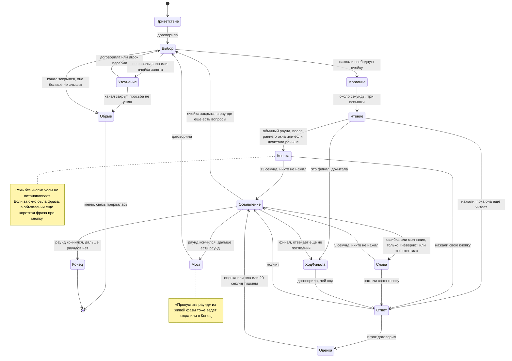
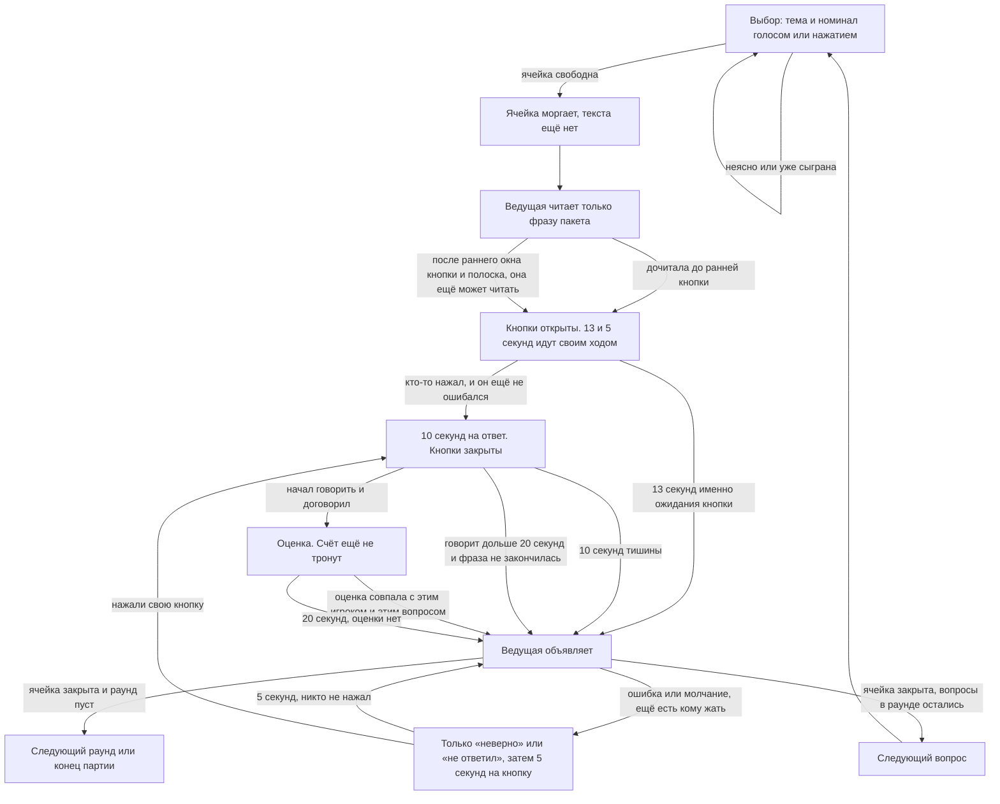
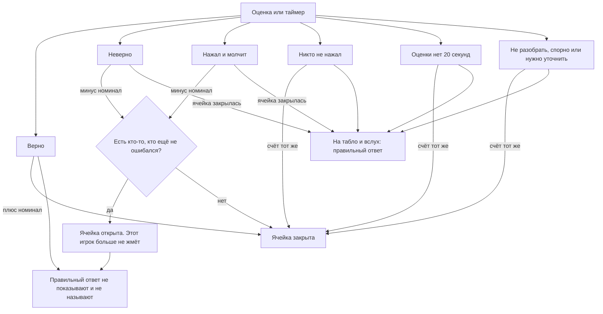
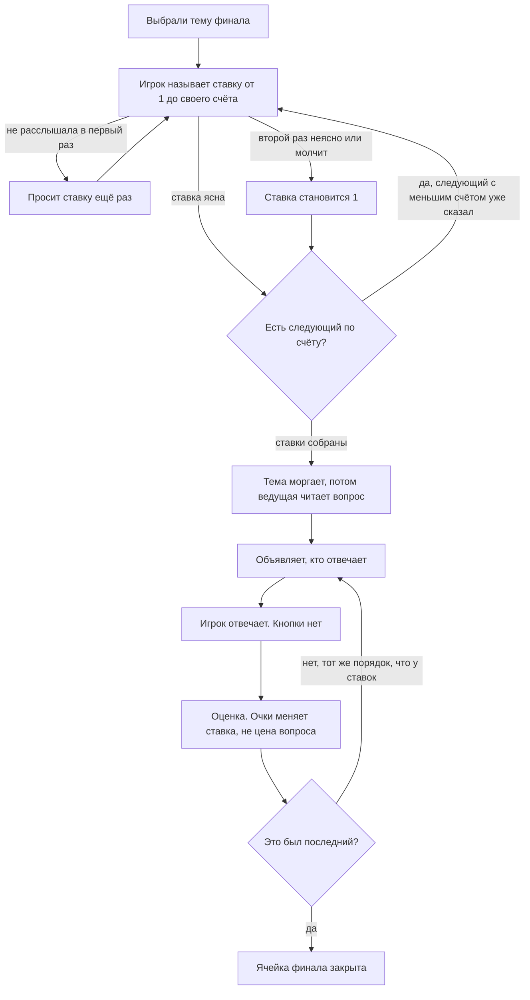
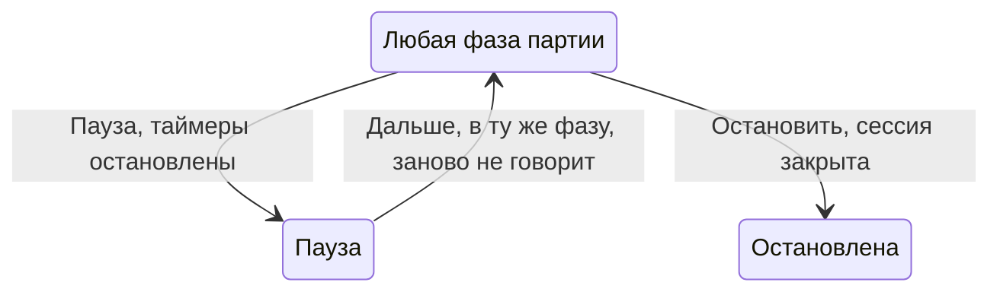

# Как сейчас идёт партия

Это то, что делает машина, когда игра уже началась. Меню и ключ сюда не входят, кроме обрыва связи: он возвращает в меню. Пауза и остановка в конце, отдельно: они не меняют счёт. Кнопка «Остановить» в шапке сейчас скрыта.

Очки меняет только машина. Ведущая только говорит. В обычном раунде правильный ответ на табло и вслух появляется, если ячейка закрылась без верного ответа: никто не ответил, ошиблись все, ответ не разобран/спорный или истёк таймер оценки. В финале это определяется последней попыткой, даже если раньше другой финалист ответил верно. После верного ответа эталон остаётся только текстовой заметкой в «Разговоре».

## Партия целиком

Кнопка «Пропустить раунд» из любой живой фазы, в том числе посреди вопроса, входит в мост, если дальше есть раунд или финал, и в конец, если раундов не осталось: счёт тот же, несыгранные ячейки пропущенного раунда не играются, остановленная и законченная партия новый раунд не открывает.

Выбор ячейки на финале и ставки разобраны ниже. Пока финал не выбран, партия крутится по левой части: выбор, вопрос, кнопка, ответ, объявление.

Кто выбирает следующий вопрос, записан в контексте машины (`chooserId`). В начале каждого раунда, включая первый и выбор темы финала, это второй игрок, если игроков хотя бы двое, иначе первый. Дальше в этом раунде выбирает тот, кто последним ответил: его попытку оценили или он промолчал уже после кнопки. Если на одну ячейку ответили несколько, выбирает последний из них. Никто не нажал — выбор не переходит. Подпись «выбирайте вопрос» и подсветка кнопки видны только пока табло ждёт ячейку или тему финала. Ведущая может назвать его по имени. Когда раунд кончился и начинается следующий, включая финал, она коротко называет имя и счёт каждого, затем объявляет раунд и просит выбрать. Темы и цены не перечисляет. Победителя называет в конце партии.

Если канал событий закрылся, пока она должна говорить, партия не ждёт эту фразу и не возвращается к выбору с закрытым ухом. Так было 9 октября: речь не распозналась, просьба повторить не ушла, портрет тридцать секунд молчал, а потом выбор остался глухим и выглядел как «Ведущая думает». Теперь это обрыв: меню и текст, что связь прервалась. Короткий запасной таймер звука срабатывает только если воспроизведение так и не началось. Если звук уже идёт, фаза ждёт его конца.

## Один обычный вопрос

На табло одна ячейка на тему и номинал. Если в пакете у этой цены несколько вопросов, они лежат стопкой в порядке файла: выбор открывает следующий несыгранный, а ячейка остаётся, пока такой вопрос есть. Вопрос, отброшенный при разборе пакета, в стопку не входит.

Звук и ролик вопроса идут после чтения, в первом окне кнопки. Кнопок у плеера нет: они сами начинают играть и крутятся, пока окно открыто. Нажатие кнопки и конец окна ставят их на паузу, снимают цикл и оставляют позицию. В пяти секундах на перехват и под объявлением ответа они молчат. Медиа ответа: медиа ответа (картинка, звук, ролик) при любом исходе с закрытой ячейкой, и после верного, видны всё объявление и пока играет клип, но не меньше `answerMediaMinMs` (3 с) и не больше `answerMediaMaxMs` (10 с) с момента показа; длинный клип обрезается на 10 с (`announcing.holding`); картинка вопроса при одном звуке ответа остаётся рядом. Короткий сигнал кнопки — отдельный звук. На музыкальном вопросе в поле звука виден индикатор уровня, который двигает сам звук; тишина и пауза оставляют его в покое. Звук и ролик вопроса и ответа проходят через мягкий лимитер Web Audio: громкие пики быстро сажает и держит, тихие чуть поднимает makeup-ом, без сильной «качки» динамики; стрелки метра читают сигнал до лимитера.

Если у вопроса в пакете есть варианты, на табло они стоят буквами под фразой, и ведущая читает их вместе с ней. Когда ответ уже можно назвать, она произносит букву и текст правильного варианта, не весь список.

На обычном вопросе с начала чтения идёт раннее окно 3–8 с по длине фразы вопроса (`earlyBuzzerMsFor`, состояние `reading.sealed`): нажатие — фальстарт. Когда оно проходит (`reading.armed`), кнопки, статус «Жмите свою кнопку» и полоска `buzzerMs` (13 с) уже живые, даже если она ещё читает: нажатие обрывает звук и отдаёт ответ. Дочитанная фраза этот отсчёт не обнуляет: остаток идёт дальше. Если 13 секунд вышли, пока она ещё читает, чтение обрывается и называется ответ. Если она дочитала раньше этой задержки, 13 секунд стартуют тогда. Речь в комнате чтение не обрывает и ответом не считается, но запоминается. В финале во время чтения кнопок нет; пауза замирает и остаток раннего окна, «Дальше» продолжает его.

Если кнопку нажали раньше, пока ячейка моргает или чтение ещё не открыло кнопку, это фальстарт. Машина запоминает игрока и время. Кнопка вспыхивает красным и гаснет `falseStartMs` (2,5 с). Пока вспышка не погасла, этот игрок нажать не может, даже если окно ответа уже открылось. Остальные жмут как обычно. Счёт и список ответивших не меняются. Пауза замирает и этот штраф. В финале и при выборе ячейки фальстарта нет. Если фальстарт на вопросе был и чтение кончилось раньше ранней кнопки, после чтения она примерно в половине случаев коротко называет имена, без ответа пакета. 13 секунд (`buzzerMs`) стартуют после этой фразы, чтобы она не съела время ответа. Если монетка молчит, часы стартуют сразу. Если первое окно кнопки уже идёт, пока она читает, эта реплика не вставляется и полоска не начинается заново. В тестах монетку подменяют.

Пока открыта кнопка, речь без кнопки очки не меняет и часы не останавливает: ни 13 секунд после чтения, ни 5 секунд на перехват. Кашель и короткий шум ничего не делают. Отдельного «нажмите кнопку» посреди окна нет. За две секунды до конца первого окна кнопки (`buzzerMs`) звучит короткий сигнал в одну секунду (`buzzerBeepMs`), и кнопку ещё можно нажать. Когда окно истекло и ячейка закрылась, она произносит один очевидный ответ пакета. Реплика про близкую попытку звучит только если выпала монетка `closeGuessCoin`, и только в этом объявлении ответа. Что кнопку не нажали и «выбирайте следующий», она не говорит. Если за это окно была настоящая фраза или её перебили во время чтения, следом одной короткой фразой говорит, что ответ называют только после кнопки. Если было тихо, этой фразы нет. После ошибки или молчания, если ещё есть кому жать, она говорит только что ответ неверный и называет списание, без приглашения на кнопку, и окно снова открыто уже на 5 секунд. Она может назвать игрока по имени.

После кнопки игрок отвечает в `answering.waiting`, а когда речь уже идёт — в `answering.hearing`. Туда же возвращается повтор после «Повторите». Если кнопку нажали посреди уже идущей реплики (в окне кнопки или чуть раньше), эта же utterance идёт в попытку ответа, а не списывается как «тишина». Распознаванию в этих фазах передаются ответы ячейки как словарь редких слов (без «возможных ответов» в кавычках), плюс явно: тишина и шум — пустая расшифровка. В окне кнопки до нажатия их нет. Если расшифровка повторила подсказку — или короткий VAD / очень низкая уверенность совпали с эталоном из словаря (фантом Whisper) — это не ответ: очки не меняются, вопрос слушается дальше. Отброшенный или чужой транскрипт в «Услышано» не пишется. Черновик речи, который растёт в чате, пока игрок говорит, — только показ: на ход игры влияет лишь итоговая расшифровка (см. [ONLINE](ONLINE.md)).

## Счёт и ячейка

Это развилка внутри «Объявление». От неё зависит, куда партия идёт дальше.

Пока после ошибки кнопка ещё открыта другим, правильного ответа нет ни на табло, ни в голосе. Если реплику услышали — коротко «неверно» и списание; если за окно ничего не услышали — свободно, что не расслышала (можно про микрофон), и тоже списание, не «неверно». Кнопку нажимать не зовёт. Остальным дают 5 секунд, не новые 10. Когда ответ всё же называют вслух, она сначала произносит один самый очевидный ответ из пакета, не весь список. Если после кнопки уже был неверный ответ и монетка `closeGuessCoin` выпала, перед эталоном одна короткая фраза, что попытка была близкой: реплика явно про то же соседним заголовком, словами игрока, без нового названия. Несколько попыток не перечисляет. Если монетка молчит, попытка про другое, это созвучие или фраза без кнопки, этой фразы нет. Пока ячейку ещё можно перехватить, близость не звучит. Если ячейка закрылась потому, что окно кнопки истекло, сигнал уже прозвучал за две секунды до конца, и фразы «кнопку не нажали» нет. Если ответ неверный или время на ответ вышло, после ответа она коротко говорит, что неверно или что время вышло. Свой ответ она не придумывает.

«Не разобрать», «спорно» и «нужно уточнить» дают итог 0: если ещё есть кому жать, вопрос остаётся открытым для перехвата (раньше закрывали). Дальше старое правило: Когда ячейка этим закрылась, она называет один очевидный ответ пакета, как и при молчании без кнопки. Пока ячейка ещё открыта — в финале, пока не ответил последний, — ответа нет. Если модель не успела оценить за 20 секунд, происходит то же самое.

Если реплика — сам эталон, после обычной нормализации регистра, знаков и пробелов, машина считает её верной, даже когда модель сказала иное. Совпадение с любым ответом ячейки достаточно; текст в скобках внутри ответа — отдельная форма целиком. Длинная фраза, где название только упомянуто, эталоном не считается. То же слово по слогам («пы ле со сел» при «пылесосел») — этот эталон, не созвучие.

Созвучная реплика — другой путь. «Читов» при «Герман Титов», «Твэнсдей» при «Уэнсдэй», «Новоселов» при «Ногу свело»: очки не меняются, ячейка остаётся открытой, тот же игрок слышит «Повторите, пожалуйста» и отвечает ещё раз, не больше одного. Следующий такой ответ — обычная ошибка. Низкая уверенность распознавания сама по себе неверный ответ не отменяет: повтор только если фраза ещё и похожа на эталон. Если уверенности в событии нет, решает одно созвучие.

## Апелляции

Только обычные вопросы, финал не меняется. У каждого игрока на вопросе один итог: −номинал, 0 или +номинал. Апелляция — новая попытка ответа, её итог заменяет прежний: три ошибки не снимают три номинала, плюс после минуса даёт +2 номинала. Право есть у того, кто уже отвечал на этот вопрос и получил 0 или минус.

- Пока вопрос открыт: после 0/минуса другим открыт 5-секундный перехват, а у последнего ответившего вместо кнопки — «Апелляция». Что первым примет мастер — апелляция, чужая кнопка или таймер, — то и решает. Победила апелляция: ведущая по имени просит повторить, вопрос не перечитывает.
- После закрытия: 5 секунд у всех с правом активна «Апелляция», выбор следующей ячейки уже доступен. Первая заявка сразу запускает ответ и блокирует выбор; остальные встают в очередь (FIFO), по одному месту на игрока. После серии — снова 5 секунд, если право ещё у кого-то есть. Выбирает тот же, кто выбирал бы без апелляций. Ячейка остаётся сыгранной.
- Последний вопрос раунда: в эти 5 секунд ведущая подводит итог — раунд окончен, счёт каждого, что впереди (второй, третий или финальный раунд) и кто выбирает. Апелляция возможна и во время этой фразы: её обслуживают, потом итог звучит заново с исправленным счётом. Окно не обрывает фразу. Отдельный мост перед раундом после итога не повторяется.
- Кнопка «Апелляция» появляется сразу после минуса, ещё пока ведущая его объявляет.
- Два вида. До объявления правильного ответа (вопрос открыт) — переответ, как выше. После объявления (ячейка закрыта) переответа нет: на месте кнопок появляются «Да, я ответил правильно» и «Нет, не надо апелляцию». «Да» — поправка счёта до +номинала и короткая реплика ведущей; «Нет» ничего не отправляет.
- Ведущая называет правильный ответ вслух в конце, только если никто не ответил верно: из нескольких вариантов эталона ровно один естественный, затем короткая связка. В чат «Правильный ответ: …» пишется всегда.
- Пока идёт серия апелляций, на экране табло, ячейки выбрать нельзя.
- Если апелляция не изменила итог (например, снова неверно при −300), ведущая так и говорит, а не «счёт обновлён».
- Кнопка: «Апелляция» → «Отправляется…» → «В очереди» / «Отвечаете»; отказ мастера показывает причину. Над рядом игроков — очередь «Апелляции: Маша → Вася».

Итог апелляции ведущая говорит своими словами по фактам: принята ли, имя, было и стало за этот вопрос (цифрами и словами), общий счёт; жёсткое требование — числа и знак точно по фактам, «было» и «стало» не путать. Готовой фразы нет (`appealResultLine` в `src/game/appealSpeech.ts` — только для заглушки). У игрока один итог за ячейку — новый заменяет прежний, это не доплата и не второе списание; на коте и аукционе сумма — ставка.

## Финал

В финал попадают игроки со счётом больше нуля, от меньшего к большему. Если такого вопроса нет или у всех счёт не выше нуля, партия заканчивается сразу.

Ответ финала не называют, пока не ответил последний, кому есть что отвечать. Если последний ответил верно, правильный ответ всё равно не показывают. Если последний ошибся или промолчал, ответ показывают и называют, даже если кто-то раньше уже ответил верно.

## Кот в мешке и аукцион (13 октября 2026)

Подробные правила и отклонения от плана — [CAT](CAT.md) и [AUCTION](AUCTION.md). Обе ячейки выбирают как обычные, голосом или кликом. У каждого клиента локально звучит «мяу» (`public/sounds/meow.wav`) или «динь-динь-динь» (`public/sounds/auction.wav`) — раз на ячейку, до фразы ведущей; на табло вместо вопроса панель с картинкой (`public/images/cat.svg`, `auction.svg`). Кнопок ответа нет на всём пути: фальстарта нет, перехвата нет, после ответа получателя ячейка закрывается. Апелляция — как у обычного вопроса, но на ставку: после минуса сразу «Апелляция», затем «Да, я ответил правильно» меняет −ставку на +ставку. Голос сначала разбирается локально; если имя или ставка не узнаны, решает изолированный вызов модели, и принимается только вариант из списка.

**Кот.** Выбравший отдаёт вопрос: голосом («отдаю Боре», «игроку три») или кнопкой с именем на панели; себе нельзя, неясное имя — переспрос. При двух игроках получатель второй автоматически, при одном — сам выбравший. Тема кота видна после выбора получателя (у `bagcat knows=before` — сразу, вместе с вариантами цены). Цена: фиксированная из `cost`, иначе выбор «минимум/максимум» (`[min;max]` или мин/макс цен раунда, `prices.ts`); выбор голосом или кнопкой. Верно — +ставка, неверно — −ставка; дальше выбирает получатель.

**Аукцион.** Ставку открывает выбравший: номинал ×1–4 (меньше его денег) или ва-банк; если денег не больше номинала — номинал автоматически. Дальше по кругу каждый, у кого денег больше текущей ставки, перекупает (+1–3 номинала или ва-банк) или пасует; пас окончательный, бедные пасуют автоматически. Ва-банк перебивается только бо́льшим ва-банком. Кто остался последним — отвечает за свою ставку, ±ставка, затем выбирает.

**Отключение.** Если тот, чьё слово сейчас решает (получатель кота, спрашиваемый на аукционе, отвечающий), пропал, все ждут 15 с (`catAwayWaitMs`, «Ждём игрока …»). Вернулся — ставка или ответ спрашиваются заново, вопрос не перечитывается. Не вернулся: на торгах — автопас; на ответе — 0 очков, ответ пакета вслух, выбирает следующий по кругу. Ушёл отдающий кота или открывающий аукцион — право переходит дальше (на аукционе — номинал автоматически).

**Демо.** Пакет «Демо», раунд «Особые» (два раза «Пропустить раунд»): «Сюрприз 200» — кот с ценой мин/макс раунда (100/300), «Сюрприз 300» — `bagcat` с известной темой «Города» и ценой 100 или 300, «Торги 200» — аукцион. Чтобы перекупить, нужны деньги: сначала сыграйте «Сюрприз 100» и «Торги 100».

## Молчание игрока (14 октября 2026)

В четырёх слушающих состояниях своего таймера нет, поэтому есть отсчёт тишины (`idle` в контексте, [src/game/idle.ts](../src/game/idle.ts), пороги `idleSteps` в [src/options.ts](../src/options.ts)). Готовых фраз нет: ведущая получает, кто молчит, сколько ждали и что будет дальше, и говорит своими словами (`idleNudgeCue`, `idleAutoCue`, ветки в `chooserHandoffCue`, `catStakeCue`, `auctionAskCue`, `auctionWonCue`).

- Выбор вопроса (`choosing.listening`): 15 с — позвать выбирающего по имени, 30 с — поторопить, 40 с — `chooserHandoff`: ведущая говорит, что игрок не выбрал, и называет следующего по кругу; выбор переходит к нему. Один игрок — выбор остаётся у него, отсчёт заново.
- Кот (`cat.picking`): 15 с — спросить, кому отдаёт; 30 с — кот уходит случайному другому игроку, ведущая объявляет это в реплике ставки.
- Ставка за кота (`cat.staking.listening`): 10 с — спросить минимум или максимум; 20 с — берём минимум, состояние `cat.autoStaked` (реплика `idleAuto`), потом вопрос.
- Аукцион (`auction.listening`): 10 с — спросить ставку; 20 с — молчание считается пасом, а если молчит открывающий — торги открываются по номиналу. Ведущая говорит это в следующей реплике торгов.

Считается только тишина: `speech_started` (ухо ведущей «Слышу…») сбрасывает отсчёт и держит его, пока игрок говорит (`IDLE_SPEECH`); пока говорит ведущая, отсчёт стоит без сброса (`HOST_TALKING`, по `link.host`). Разбор (`*.resolving`) — другое состояние, отсчёт не идёт; после уточнения ведущей (`*.clarifying` → listening) — заново. Реплики-напоминания — `idleNudge`, контроллер говорит их на каждое увеличение `idleNudges`. Таймеры живут в машине мастера; гостям уходят речь ведущей и смена состояния, как обычно. Подсказка про выключенный микрофон не изменилась.

Демо: в заглушке до «Начать игру» выполнить `__aisigame.setIdleScale(0.1)` (в 10 раз быстрее: 1,5 / 3 / 4 с; применяется с ближайшего входа в слушающее состояние), `setIdleScale(1)` — как в игре.

Окно апелляции — 5 с (`APPEAL_WINDOW_MS`). Демо/e2e: `__aisigame.setAppealScale(4)` растягивает его в четыре раза.

## Пауза и остановка

На паузе часы не идут. При «Дальше» большинство окон (кнопка, ответ, ставка, оценка) начинается полной длительностью; остаток раннего окна и штраф фальстарта сохраняется. Это не сохранение остатка всех таймеров; точные ветки — STATES.

«Остановить» закрывает сессию и оставляет экран партии, снимок не стирает. Кнопка в шапке сейчас скрыта. «Выход» сначала спрашивает «Выйти из игры?» через `window.confirm`. Отмена оставляет партию и сохранение; подтверждение у мастера/за столом выходит из партии и удаляет сохранение; joiner только покидает комнату, это уже не ход игры.

В конференции «Продолжить прошлую игру» у мастера возвращает также всю сохранённую историю последних 200 сообщений: реплики ведущей, услышанное, оценку, подписи эталонов и текстовый чат. История хранится одним кольцевым буфером в снимке, включая лобби и паузу; новая реплика записывается в следующий слот.

В конференции при сборе финальных ставок модель слышит текущего игрока finalists[finalCursor], в том числе с галкой «Меньше слышать».

13 октября 2026: по решению автора удалён speechSynthesis и localSpeech. После одного неуспешного повтора точной фразы моделью или таймаута неверный звук сбрасывается и посылается обычное завершение чтения; текст пакета остаётся на экране. Состояния/таймеры XState не менялись. Задача передачи браузерного TTS игрокам удалена из to-do.

## Контекст и альтернативные ответы

Свободные комментарии используют публичную историю и актуальный счёт; чтение вопроса и оценка ответа историю не используют. За столом история берётся из trace текущей сессии, в конференции — из сохраняемого кольца последних сообщений. Это ограниченная история, не бесконечная память всей партии.

Оценке передаются полный текст вопроса (включая варианты), эталонные ответы пакета и текущая реплика. Список эталонов не обязательно исчерпывающий: модель может вернуть correct для другой фактически верной реплики, удовлетворяющей всем ограничениям вопроса. Простая тематическая связь или созвучие недостаточны. При сомнении — ambiguous. Для вопроса с заданными вариантами сохраняется правило правильного варианта; другой вариант не принимается только из-за похожести. В текстовом пути точный эталон по-прежнему форсирует correct; в аудиопути ambiguous/unintelligible не превращаются в correct только из-за совпадения heard с эталоном. Счёт меняет машина.

### Источник оценки обычного ответа

По умолчанию OpenAI оценивает ответ по аудио; переключатель «Оценивать по аудио» возвращает прежний ASR→text judge. `?judge=audio` на двух моделях OpenAI оценивает уже стримленную аудиореплику + вопрос/эталоны через isolated item_reference. Она не ждёт ASR. В публичном «Услышано» и оценке — услышанное аудиосудьёй; late ASR не заменяет его. При технической ошибке/ready timeout — один text fallback в прежнем judgeMs, содержательная ошибка ответа не запускает вторую оценку. `?judge=shadow` оставляет text authoritative и сравнивает аудио только в debug. Grok/Gemini и финал остаются text; live-приёмка OpenAI ещё впереди. Фазы, начисление и ручные апелляции этой правкой не меняются. [Контракты и проверка](AUDIO_JUDGMENT.md#15-поставленная-реализация-и-запуск-проверки).

## Переход после ответа и эталон в чате (13 октября 2026)

Как только ячейка закрыта (верно, все ошиблись, никто не нажал, тайм-аут, апелляция) и в обычном раунде ещё есть вопросы, табло показывается сразу, пока ведущая комментирует итог. Выбирающий может кликнуть ячейку — это обрывает речь и открывает вопрос (`earlyPickOpen` в машине, тот же гард у мастера для `pick` гостей). Не действует в финале, при повторе, во время апелляции, на последнем вопросе раунда и если у ответа есть медиа (карточку ответа держит `announcing.holding`). Голосом в это время выбрать нельзя — только кликом. Эталон пакета всегда пишется в чат отдельной строкой «Правильный ответ: …» сразу при входе в объявление, один раз на вопрос и независимо от того, прозвучала ли речь; в финале — после последнего финалиста.

При чтении вопроса модель получает только текст вопроса (`conversation: none`); инструкция прямо запрещает на него отвечать, а если по расшифровке ведущая продолжает говорить после дословной фразы, клиент обрывает звук (`speechOverruns`). Все свободные реплики требуют одну короткую фразу без связок и ремарок (`cueBrevity`).
