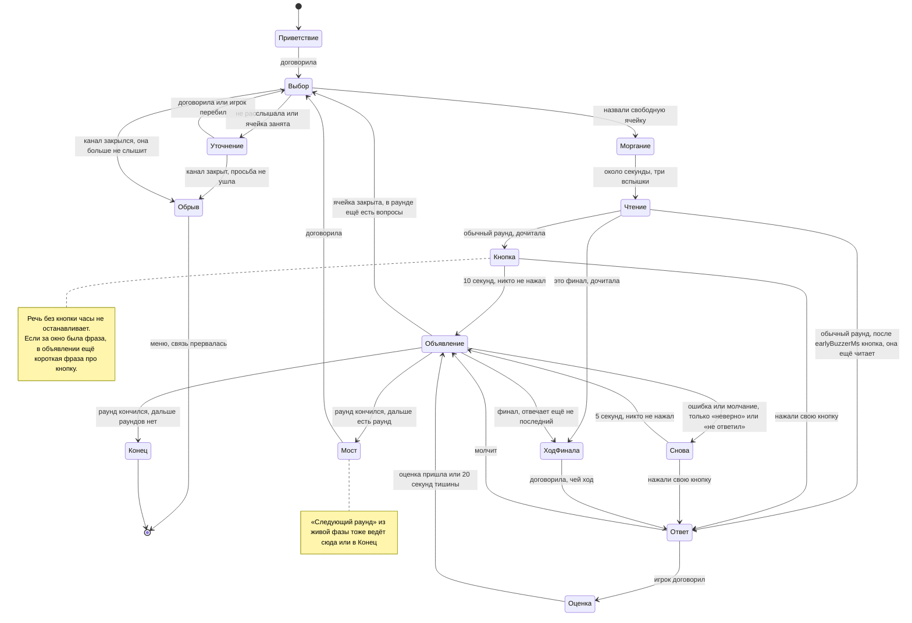
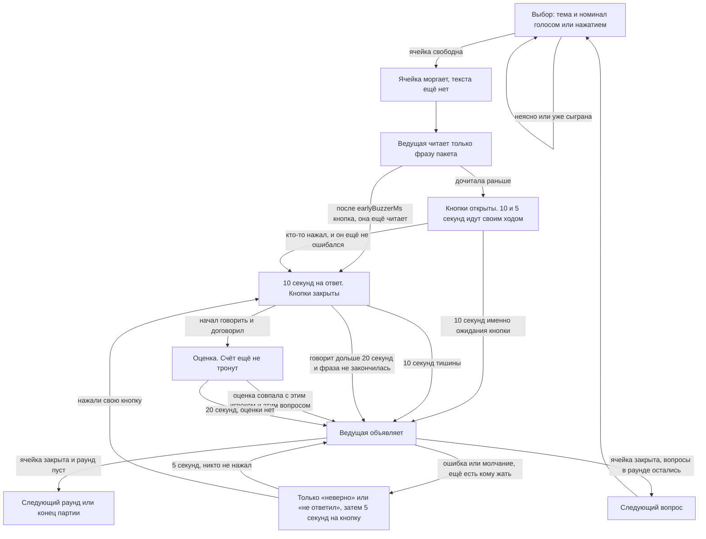
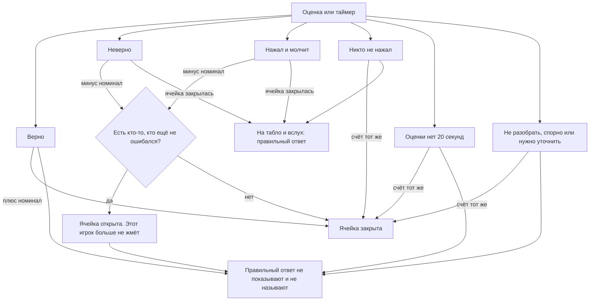
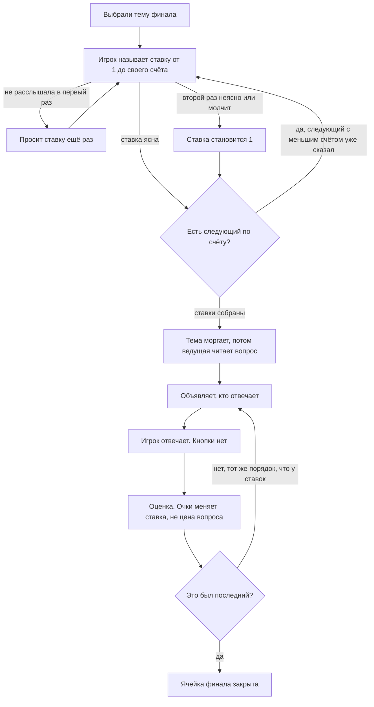
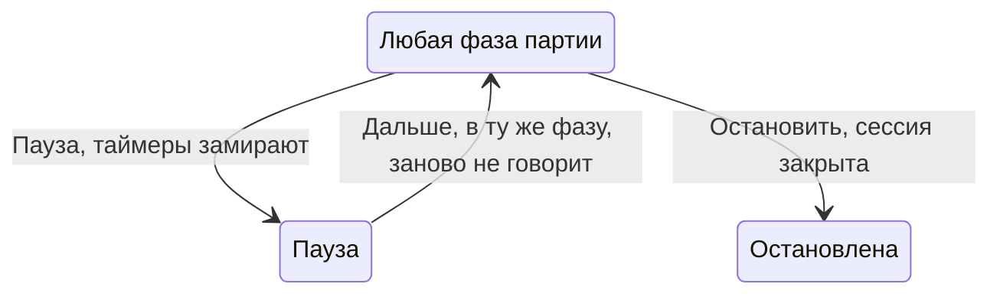

# Как сейчас идёт партия

Это то, что делает машина, когда игра уже началась. Меню и ключ сюда не входят, кроме обрыва связи: он возвращает в меню. Пауза и остановка в конце, отдельно: они не меняют счёт. Кнопка «Остановить» в шапке сейчас скрыта.

Очки меняет только машина. Ведущая только говорит. Правильный ответ на табло и вслух появляется, только если ячейка закрылась без верного: никто не ответил или все, кто мог, ответили неверно.

## Партия целиком

Кнопка «Следующий раунд» из любой живой фазы, в том числе посреди вопроса, входит в мост, если дальше есть раунд или финал, и в конец, если раундов не осталось: счёт тот же, несыгранные ячейки пропущенного раунда не играются, остановленная и законченная партия новый раунд не открывает.

Выбор ячейки на финале и ставки разобраны ниже. Пока финал не выбран, партия крутится по левой части: выбор, вопрос, кнопка, ответ, объявление.

Кто выбирает следующий вопрос, записан в контексте машины (`chooserId`). В начале каждого раунда, включая первый и выбор темы финала, это второй игрок, если игроков хотя бы двое, иначе первый. Дальше в этом раунде выбирает тот, кто последним ответил: его попытку оценили или он промолчал уже после кнопки. Если на одну ячейку ответили несколько, выбирает последний из них. Никто не нажал — выбор не переходит. Подпись «выбирайте вопрос» и подсветка кнопки видны только пока табло ждёт ячейку или тему финала. Ведущая может назвать его по имени. Когда раунд кончился и начинается следующий, включая финал, она коротко называет имя и счёт каждого, затем объявляет раунд и просит выбрать. Темы и цены не перечисляет. Победителя называет в конце партии.

Если канал событий закрылся, пока она должна говорить, партия не ждёт эту фразу и не возвращается к выбору с закрытым ухом. Так было 9 октября: речь не распозналась, просьба повторить не ушла, портрет тридцать секунд молчал, а потом выбор остался глухим и выглядел как «Ведущая думает». Теперь это обрыв: меню и текст, что связь прервалась. Короткий запасной таймер звука срабатывает только если воспроизведение так и не началось. Если звук уже идёт, фаза ждёт его конца.

## Один обычный вопрос

На табло одна ячейка на тему и номинал. Если в пакете у этой цены несколько вопросов, они лежат стопкой в порядке файла: выбор открывает следующий несыгранный, а ячейка остаётся, пока такой вопрос есть. Вопрос, отброшенный при разборе пакета, в стопку не входит.

Звук и ролик вопроса идут после чтения, в первом окне кнопки. Нажатие кнопки и конец окна ставят их на паузу и оставляют позицию. В пяти секундах на перехват они молчат. Короткий сигнал кнопки — отдельный звук.

Если у вопроса в пакете есть варианты, на табло они стоят буквами под фразой, и ведущая читает их вместе с ней. Когда ответ уже можно назвать, она произносит букву и текст правильного варианта, не весь список.

На обычном вопросе с начала чтения идёт окно `earlyBuzzerMs` (состояние `reading.sealed`): нажатие — фальстарт. Когда оно проходит (`reading.armed`), кнопки уже живые, даже если она ещё читает: нажатие обрывает звук и отдаёт ответ, а 10 секунд и полоска стартуют только когда она дочитала. Речь в комнате чтение не обрывает и ответом не считается, но запоминается. В финале во время чтения кнопок нет; пауза замирает и остаток `earlyBuzzerMs`, «Дальше» продолжает его.

Если кнопку нажали раньше, пока ячейка моргает или чтение ещё не открыло кнопку, это фальстарт. Машина запоминает игрока и время. Кнопка вспыхивает красным и гаснет `falseStartMs` (2,5 с). Пока вспышка не погасла, этот игрок нажать не может, даже если окно ответа уже открылось. Остальные жмут как обычно. Счёт и список ответивших не меняются. Пауза замирает и этот штраф. В финале и при выборе ячейки фальстарта нет. Если фальстарт на вопросе был, после чтения она примерно в половине случаев коротко называет имена, без ответа пакета. Десять секунд стартуют после этой фразы, чтобы она не съела время ответа. Если монетка молчит, часы стартуют сразу. В тестах монетку подменяют.

Пока открыта кнопка, речь без кнопки очки не меняет и часы не останавливает: ни 10 секунд после чтения, ни 5 секунд на перехват. Кашель и короткий шум ничего не делают. Отдельного «нажмите кнопку» посреди окна нет. За две секунды до конца десятисекундного окна звучит короткий сигнал в одну секунду (`buzzerBeepMs`), и кнопку ещё можно нажать. Когда окно истекло и ячейка закрылась, она произносит один очевидный ответ пакета. Реплика про близкую попытку звучит только если выпала монетка `closeGuessCoin`, и только в этом объявлении ответа. Что кнопку не нажали и «выбирайте следующий», она не говорит. Если за это окно была настоящая фраза или её перебили во время чтения, следом одной короткой фразой говорит, что ответ называют только после кнопки. Если было тихо, этой фразы нет. После ошибки или молчания, если ещё есть кому жать, она говорит только что ответ неверный и называет списание, без приглашения на кнопку, и окно снова открыто уже на 5 секунд. Она может назвать игрока по имени.

После кнопки игрок отвечает в `answering.waiting`, а когда речь уже идёт — в `answering.hearing`. Туда же возвращается повтор после «Повторите». Распознаванию в этих фазах передаются ответы ячейки, без текста вопроса и без тем. В окне кнопки до нажатия их нет. Если расшифровка повторила подсказку, это не ответ: очки не меняются, вопрос слушается дальше.

## Счёт и ячейка

Это развилка внутри «Объявление». От неё зависит, куда партия идёт дальше.

Пока после ошибки кнопка ещё открыта другим, правильного ответа нет ни на табло, ни в голосе. Ведущая говорит только «неверно» или «не ответил» и называет списание. Кнопку нажимать не зовёт. Остальным дают 5 секунд, не новые 10. Когда ответ всё же называют вслух, она сначала произносит один самый очевидный ответ из пакета, не весь список. Если после кнопки уже был неверный ответ и монетка `closeGuessCoin` выпала, перед эталоном одна короткая фраза, что попытка была близкой: реплика явно про то же соседним заголовком, словами игрока, без нового названия. Несколько попыток не перечисляет. Если монетка молчит, попытка про другое, это созвучие или фраза без кнопки, этой фразы нет. Пока ячейку ещё можно перехватить, близость не звучит. Если ячейка закрылась потому, что окно кнопки истекло, сигнал уже прозвучал за две секунды до конца, и фразы «кнопку не нажали» нет. Если ответ неверный или время на ответ вышло, после ответа она коротко говорит, что неверно или что время вышло. Свой ответ она не придумывает.

«Не разобрать», «спорно» и «нужно уточнить» вопрос закрывают и очки не меняют. Правильный ответ при этом не называют. Если модель не успела оценить за 20 секунд, происходит то же самое.

Если реплика — сам эталон, после обычной нормализации регистра, знаков и пробелов, машина считает её верной, даже когда модель сказала иное. Совпадение с любым ответом ячейки достаточно; текст в скобках внутри ответа — отдельная форма целиком. Длинная фраза, где название только упомянуто, эталоном не считается. То же слово по слогам («пы ле со сел» при «пылесосел») — этот эталон, не созвучие.

Созвучная реплика — другой путь. «Читов» при «Герман Титов», «Твэнсдей» при «Уэнсдэй», «Новоселов» при «Ногу свело»: очки не меняются, ячейка остаётся открытой, тот же игрок слышит «Повторите, пожалуйста» и отвечает ещё раз, не больше одного. Следующий такой ответ — обычная ошибка. Низкая уверенность распознавания сама по себе неверный ответ не отменяет: повтор только если фраза ещё и похожа на эталон. Если уверенности в событии нет, решает одно созвучие.

## Финал

В финал попадают игроки со счётом больше нуля, от меньшего к большему. Если такого вопроса нет или у всех счёт не выше нуля, партия заканчивается сразу.

Ответ финала не называют, пока не ответил последний, кому есть что отвечать. Если последний ответил верно, правильный ответ всё равно не показывают. Если последний ошибся или промолчал, ответ показывают и называют, даже если кто-то раньше уже ответил верно.

## Пауза и остановка

«Остановить» закрывает сессию и оставляет экран партии, снимок не стирает. Кнопка в шапке сейчас скрыта. «Выход» выходит из партии и удаляет сохранение, это уже не ход игры.
