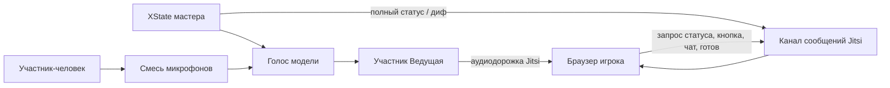

# Онлайн-режим через Jitsi

Статус на 13 октября 2026: конференция реализована; ниже описан текущий код. Будущие изменения вынесены в UNIFY_MODES. Сервер Jitsi поднимается отдельно: [JITSI.md](JITSI.md).

Режим «За столом» не меняется: один браузер, одна машина XState, микрофон комнаты, те же e2e. Конференция — отдельная ветка до `START_GAME` и отдельная отрисовка для тех, кто зашёл по ссылке.

## Как это устроено

Мастер — браузер, который создал комнату. Он один вводит ключ модели, один запускает ведущую и один крутит [src/game/machine.ts](../src/game/machine.ts). Остальные браузеры машину не запускают: жмут кнопку, пишут в чат и рисуют снимок, который прислал мастер.

В комнате Jitsi у мастера два участника. Человек — с именем игрока, микрофоном и камерой. «Ведущая» — второе подключение того же браузера, только звук модели. Своё аудио «Ведущей» мастер не проигрывает из конференции: он и так слышит его локально. В смесь для модели дорожка «Ведущей» не входит, иначе она услышит сама себя. В ряде участников бот не рисуется: камеры у неё нет. Уровень её речи из Jitsi (`subscribeHostSpeaking`) пульсирует золотой рамкой на портрете ведущей над колонкой «Разговор» — та же анимация, что у говорящих плиток.

Игроки слышат ведущую из конференции. Их микрофоны мастер смешивает и отдаёт модели только в те фазы, где контроллер и сейчас включает микрофон. Выключенный микрофон конференции значит, что этого человека не слышат ни игроки, ни модель.

## Старт

Карточка [src/ui/StartScreen.tsx](../src/ui/StartScreen.tsx) имеет ширину `min(960px, 100%)` и два столбца на широком экране. Слева пакет и имена, справа модель и ключ. Прямо над кнопками переключатель:

- **За столом** — как сейчас, поле всех имён.
- **Конференция** — одно поле «Ваше имя». Адрес Jitsi виден только здесь. По умолчанию `https://fallout-nevada.ru/jitsi`, без слэша в конце. Это публичный путь за nginx, не адрес контейнера.

Подписи «Пакет вопросов», «Имена игроков», «Модель», «Ключ …» остаются в том же порядке в DOM, чтобы тест порядка полей в [e2e/match.play.ts](../e2e/match.play.ts) не разъехался. Переключатель и адрес Jitsi стоят после них.

«За столом» по-прежнему зовёт `START_GAME` и ничего не знает про Jitsi. Библиотеку конференции подгружаем только в режиме конференции.

## Подключение к серверу

Поле — базовый URL пути `/jitsi`, не готовый websocket и не порт контейнера. Для `https://fallout-nevada.ru/jitsi` клиент сам собирает:

- `https://fallout-nevada.ru/jitsi/config.js`
- `https://fallout-nevada.ru/jitsi/libs/lib-jitsi-meet.min.js`
- `wss://fallout-nevada.ru/jitsi/xmpp-websocket`

Если в поле схема `http`, websocket будет `ws`. Рабочий сервер — `https`, потому что TLS заканчивается на nginx.

`config.js` читаем как текст и не исполняем. Оттуда берём только `config.hosts.domain`: в docker-jitsi это внутреннее имя `meet.jitsi`, не публичный хост. `hosts.muc` берём, только если в файле это готовая строка в кавычках; иначе `muc.` плюс domain. `hosts.focus` так же, иначе `focus.` плюс domain. Адрес websocket из `config.js` не используем: при поддоменах шаблон склеивает его в JavaScript, а путь должен совпасть с полем и с `location` nginx.

Библиотеку грузим скриптом с `{база}/libs/lib-jitsi-meet.min.js`, чтобы она совпала с сервером, а не из npm.

Пока сервер из [docs/JITSI.md](JITSI.md) не поднят, `{база}/config.js` отвечает 404. Тогда на экране ошибка, партия не стартует. Режим «За столом» от этого не зависит.

В конференции `p2p` выключен. После XMPP слушаем `connection.connectionEstablished` (не `connection.connected`): иначе вход в комнату не вызывается и «Начать игру» зависает. Служебные сообщения — `conference.endpoint_message_received` (участник и полезная нагрузка). `conference.joined` ещё не означает, что BridgeChannel уже готов: ранние снимки складываются в FIFO-очередь, повторяются с короткой задержкой и сразу выпускаются по `conference.dataChannelOpened`. Исключение `BridgeChannel has not been initialized yet` не закрывает комнату. Комната Jitsi называется UUID партии.

## Сервер

Запуск Docker и nginx вынесен в [docs/JITSI.md](JITSI.md). Здесь остаётся только адрес, который вводит мастер: `https://fallout-nevada.ru/jitsi`.

## Ссылка и кто есть кто

Мастер один раз делает `crypto.randomUUID()` комнаты и свой `clientId`. Ссылка — полный адрес приложения, не голый origin. База берётся из `location.origin` и `import.meta.env.BASE_URL`, как пакеты в [src/game/catalog.ts](../src/game/catalog.ts). В сборке Vite `base` равен `/aisigame/`, в `npm run dev` — `/`. Текущие query-параметры в ссылку не копируются; исключение — явный локальный тестовый `?transport=broadcast`, который добавляет в приглашение `transport=broadcast`. `?mock=1` выбирает только мок-модель и не мешает открыть с телефона настоящую Jitsi-конференцию.

На GitHub Pages получается `https://roginvs.github.io/aisigame/?join={uuid комнаты}&jitsi={базовый URL}`. При открытии приложения на `http://127.0.0.1:5173/` origin приглашения автоматически заменяется на туннель `https://dev.fallout-nevada.ru/`, чтобы ссылка и QR-код открывались на телефоне. Остальные origin не переписываются. Без `/aisigame/` страница Pages не откроет игру.

Кнопка «Ссылка для игры» в лобби и в шапке партии открывает модальный диалог. В нём локально генерируется QR-код, показан полный URL, есть «Скопировать ссылку» и «Закрыть»; Escape и нажатие на фон тоже закрывают окно. После успешной записи в clipboard кнопка на две секунды показывает «Скопировано»; обе подписи постоянно занимают одно grid-место, поэтому ширина не прыгает. По ссылке человек не становится мастером. Параметры `join` и `jitsi` читаются с адреса, на котором открыто приложение, уже с учётом этого пути.

Переход по ссылке сам ничего не открывает. В адресе лежит чужой адрес Jitsi, и с него ещё грузится скрипт библиотеки, поэтому до нажатия кнопки нет ни websocket, ни загрузки скрипта, ни микрофона, ни скачивания пакета. На экране подтверждение: куда ведёт ссылка (хост из параметра `jitsi`), поле «Ваше имя» — уже подставлено, если оно сохранено, — и две кнопки. «Подключиться» запоминает имя и только тогда входит в комнату. «Не входить» оставляет обычное меню, параметры приглашения больше не действуют. То же подтверждение при каждой загрузке страницы со ссылкой, в том числе после обновления: прошлый вход его не отменяет. Сохранение мастера при отказе не стирается. Если в этой же вкладке сохранена та же комната и её маркер мастера в `sessionStorage`, после «Подключиться» она входит мастером. Соседняя вкладка того же браузера делит `localStorage`, но маркера вкладки не имеет и по приглашению входит игроком.

`clientId` мастера лежит в `localStorage` (`aisigame.clientId`) и не меняется, id вкладки игрока — в `sessionStorage`. Рядом с id игрок хранит случайный секрет вкладки. Мастер связывает `clientId`, секрет и реальный endpoint Jitsi: сообщение с чужого endpoint или с неверным секретом не управляет кнопкой, выбором и чатом. После реконнекта новый endpoint принимается только с прежним секретом. Имя чата мастер берёт из roster, а не из payload сообщения. Снимки и куски пакета несут устойчивый секрет мастера; игрок закрепляет endpoint мастера и не принимает их от другого участника. Все входящие JSON-сообщения проходят проверку структуры и ограничений размеров до обработчика.

В `snapshot` и `packOffer` мастер пишет `commit` — `buildCommit()` (в production хеш коммита сборки, в dev обычно `dev`). Joiner сравнивает со своим: при расхождении или если поля нет, показывает «Версия не совпадает с мастером: у вас …, у мастера …», рвёт комнату и пакет не качает. Это не путать с `version` в `aisigame.game` (схема снимка localStorage).

Имя конференции — отдельно от списка имён режима «За столом». Числовой `id` игрока, как сейчас в [src/game/types.ts](../src/game/types.ts), выдаёт мастер при первом hello и больше не переиспользует. В `Player` есть необязательный `clientId`. В режиме «За столом» его нет.

Мастер — первый игрок. Пока он один, выбирает он сам. Когда игроков двое и больше, первый выбор темы по-прежнему у второго.

## Лобби

После «Начать игру» в конференции мастер ещё не шлёт `START_GAME`. Он входит в комнату, подключает модель и ведущую и видит экран партии: на месте табло — короткий глобальный статус («Ждём начала игры» / «Ждём мастер-игрока» / отключение мастера), справа колонка «Разговор», без отдельной правой видеополосы.

Ряд участников под табло компактный (ограничен по высоте, чтобы не съедать поле): камера (или имя), «мик выкл.», пульс рамки при речи; у гостей — полоска пакета и статус фазы (`packPhase` + %, скорость и ETA из `packAck` → `presence`); у мастера — метка «мастер» без полоски; серый вид при `stale`. Пока поднимается прямой канал — «Устанавливаю соединение»; после первого open/процента фаза липкая (`stickyPackPhase`): heartbeat-`hello` и краткий reconnect pipe не мигают connecting поверх «Загрузка N%». После сверки карточка сразу «Пакет сверен», ещё до «Я готов» (`packVerified`). «Начать игру» у мастера и «Я готов» у joiner — на всю ширину над медиа-рядом в подвале чата (disabled до сверки sha256 / после ready); у всех, включая мастера, там же ряд «Микрофон · Камера · Следующая камера», затем поле чата. После старта партии в ряде участников вместо прогресса — счёт и buzzer.

Если кто-то ещё качает, хеш не сошёлся или игрок не нажал «готов», мастер видит обычный `confirm`: начать можно, потому что люди могут зайти посреди партии. После старта «Я готов» больше не нужна. Пока хеш пакета не сошёлся, нажатия кнопки этого игрока мастер выбрасывает.

Кто подтвердил вход раньше мастера, видит на табло «Ждём мастер-игрока». Hello уходит с именем с экрана подтверждения.

Кто зашёл посреди партии, качает файл с процентами. Играть он начинает только после обязательной проверки хеша: мастер добавляет его событием `ADD_PLAYER`, счёт с нуля, числовой id новый. До совпадения хеша кнопка не действует.

Сигнал раз в 3 секунды. 10 секунд тишины — игрок серый (`stale`), это уходит всем в снимке. Если сейчас от него ждут выбор ячейки или темы финала, мастер выбирает следующего по кругу из не-`stale` игроков (включая себя), шлёт машине `CHOOSER_OFFLINE`, и ведущая свободно объявляет отключение и нового выбирающего; до конца фразы выбор закрыт. При продолжении партии отсутствующему выбирающему тоже даётся 10 секунд на возврат. Если игрок уже нажал кнопку и отвечает, никого не подставляем — обычные `answerMs` и `judgeMs` доводят попытку до конца. Минута тишины — пропадает с табло, но мастер помнит `clientId` и счёт. Тот же id после перезагрузки возвращает того же игрока и тот же счёт. Если 10 секунд нет мастера, на табло «Мастер-игрок отключился». Перехватывать роль мастера нельзя.

### Что говорит ведущая в лобби

Пока партия ещё не началась, ведущая вслух ведёт комнату. Фразы не зашиваем списком: контроллер отдаёт модели короткие факты о лобби, а она сама решает, что сейчас уместно сказать — живо, коротко, без лишней болтовни и без тишины на каждом важном шаге. Тон тот же, что в партии: тёплый, чуть кокетливый.

Когда мастер только вошёл и модель уже подключена, она объявляет, что игра создана, называет пакет и коротко рассказывает, что в нём известно из разбора `.siq`: сколько раундов, есть ли финал, сколько тем или вопросов, если это видно без лишнего. Не перечисляет темы и номиналы целиком — они на табло после старта. В конце той же реплики или сразу следом — что ждём игроков.

Дальше модель получает смену состава и статусов: кто подключился, кто скачал пакет и сверил хеш, кто нажал «готов», что кто-то отвалился или снова появился. Она может назвать имя («о, к нам Вася») или собрать несколько событий в одну короткую сводку, если они пришли кучей. Начальная реплика сразу фиксирует исходную сигнатуру roster, поэтому через секунду не повторяется. Между событийными репликами не меньше 15 секунд: изменения внутри этого окна накапливаются, и по окончании звучит только актуальная сводка. Любая реплика лобби стартует только после ~2.5 с тишины людей в комнате, чтобы не врезаться в разговор; модель при этом продолжает слышать общий микс. Если статус не менялся, раз в 25 секунд ведущая спокойно напоминает состав: кого ещё ждём, кто качает (можно коротко по ETA из снимка), кто не нажал «готов»; может подхватить недавний разговор. Тон нейтральный: без «почти готовы» и без «можно начинать», пока есть неготовые гости. Обычно два коротких предложения, для перечня имён можно три. На каждое мелкое обновление полоски скачивания она не отвечает и проценты/скорость вслух не читает. Только когда все гости в комнате скачали пакет и нажали «готов» — тепло говорит, что все готовы и можно начинать; кнопку «Начать игру» при этом жмёт только мастер.

Инструкция хода лобби явно отдаёт модели право молчать, если с прошлого раза ничего существенного не случилось, и право суммировать, если накопилось. Готовых шаблонов «скажи ровно эту фразу» в коде нет: только факты и тон. Повторный `packVerified` уже готового игрока обновляет хеш и процент, но не сбрасывает `ready`, поэтому heartbeat не выглядит как новое событие. Реплики лобби, как и остальные, слышат все через дорожку «Ведущей» в Jitsi и пишутся в колонку «Разговор» снимка.

## Файл пакета

Снимки, hello, ready, кнопка, чат и сигнализация идут через Jitsi Bridge (`sendEndpointMessage`). Сам файл пакета — **прямым WebRTC data channel** между мастером и каждым joiner: Jitsi только устанавливает соединение (SDP offer/answer и ICE: `packPipeOffer` / `packPipeAnswer` / `packPipeIce`). Куски бинарные, без base64 и без моста JVB. Локальный тест `?transport=broadcast` по-прежнему гоняет offer/куски по BroadcastChannel без peer connection.

После `hello` мастер поднимает `RTCPeerConnection` и data channel `aisigame-pack`, шлёт offer по endpoint; joiner отвечает и обменивается ICE (STUN `stun.l.google.com`). Когда канал открыт и клиент запросил передачу — `packOffer` и куски по DC; `packAck` тоже предпочитает DC, иначе падает на Bridge. **Fallback:** если за 30 с (`PACK_PIPE_FALLBACK_MS`) после первого `hello` data channel к этому игроку так и не открылся, мастер для него переключается на старую передачу: `packOffer` и base64-куски `packChunk` через Jitsi Bridge (как до a23ff71); joiner в режиме pipe тоже принимает их с Bridge. Решение на игрока; перезагрузка игрока (новый endpoint) снова даёт WebRTC 30 с. Новый или поздний игрок всегда получает свой peer; повторный `hello` не сбрасывает уже начатую сборку и не обнуляет `percent`/`packPhase` в presence. В снимок партии байты не кладём: в `localStorage` архив до 99 МБ не влезает. Байты мастера и уже проверенный файл игрока лежат в IndexedDB. Ключ записи — sha256 тех же байтов.

В глобальном состоянии мастер хранит `pack: { hash, size, name, summary }`, включая hex-хеш исходного файла. Клиент запускает проверку IndexedDB по этому описанию сразу после полного статуса или смены пакета; отдельный `packOffer` не нужен. При валидном кеше файл открывается локально, мастер не шлёт куски. При отсутствии или порче записи клиент отправляет `packAck` с `nextIndex: 0`, и только тогда мастер начинает передачу. Это тот же `sha256Hex` из [src/game/savedGame.ts](../src/game/savedGame.ts), что уже пишется в снимок своего пакета. Игрок обязан посчитать sha256 собранных байтов и сравнить с присланным. Пока они не равны, файл не разбирается, в IndexedDB как готовый не пишется, «Я готов» выключена, кнопку мастер не принимает. При несовпадении приёмник очищает куски, показывает ошибку и подтверждает индекс 0, чтобы мастер передал файл заново.

Куски 64 КБ (`CHUNK_BYTES`), в полёте не больше 16 штук и не больше 512 КиБ сырых байтов (`CHUNK_WINDOW` / `CHUNK_WINDOW_BYTES`), подтверждение непрерывного префикса, потерянные куски шлём снова. Пока у прямого data channel `bufferedAmount` выше ~256 КиБ, новые куски не кладём (ждём `bufferedamountlow`). Для joiner живой мастер — не только свежий снимок: сигналы pipe и куски по DC тоже обновляют «мастер на связи». На карточке и в статусе загрузки фазы: «Устанавливаю соединение» (только до первого прогресса), «Загрузка N%» (скорость и ETA по ACK у мастера), «Сверка…», «Пакет сверен» / «готов»; при обрыве peer — «Нет соединения · повтор…»; mid-transfer connecting не показывается, пока percent > 0 или передача уже шла. Сто процентов означают, что байты собраны и хеш совпал, а не только что пришёл последний кусок.

Проверенные байты игрока сохраняются в IndexedDB. При следующем подключении игрок читает запись по хешу из глобального статуса, проверяет размер и заново считает sha256. Совпавший кэш сразу разбирается без передачи чанков; битая запись удаляется, и игрок подтверждает индекс 0, запрашивая чистую передачу.

До сверки клиент отправляет `packStatus` (hash, percent 0–99, packPhase connecting/downloading/verifying). Мастер снимает прежние hashOk/ready и распространяет актуальный presence; прогресс/скорость/ETA при передаче по-прежнему идут через ACK. После проверки sha256 **и** разбора приходит `packVerified`; `ready` остаётся отдельным действием в лобби. Готовность старой страницы не переносится на перезагруженную.

При closed/failed прямого канала мастер сбрасывает окно отправки, сохраняя запрос пакета. Новый канал повторяет offer и окно с начала; приёмник сохраняет уже полученные куски и своим ACK пропускает собранный префикс. Joiner пересоздаёт closed/failed peer по новому offer. Это восстановление передачи, а не автоматическое восстановление всей Jitsi-комнаты. TURN и запасного пути передачи пакета сейчас нет.

При смене endpoint с прежним clientId и секретом мастер сбрасывает старые ACK/offer и состояние загрузки, закрывает прежний peer и создаёт новый. id и счёт сохраняются. Старые callbacks и запоздавший SDP не трогают новое соединение. Обычные heartbeat того же endpoint ничего не перезапускают. Это относится и к кешу: новая страница сама подтверждает актуальный файл по глобальному хешу, мастер не объявляет её проверенной заранее.

Игрок разбирает `.siq` у себя только после совпадения хеша. В снимке только id вопросов, не blob-адреса. Картинка, звук и ролик вопроса играют локально из своего файла, в конференцию их не гоним.

Метаданные конференции, UUID комнаты, roster со счётом и свой файл мастера сохраняются. Само лобби пишется в `aisigame.game` сразу после успешного открытия комнаты, ещё до `START_GAME`. Поэтому обновление страницы мастера оставляет «Продолжить прошлую игру» активной: продолжение снова открывает тот же roomId как лобби и не посылает машине `CONTINUE_GAME`. Если партия уже началась, продолжение возвращает текущую игровую фазу без промежуточного lobby snapshot. Вернувшийся `clientId` получает прежний числовой id и счёт; при новом endpoint игрок повторяет `hello` и `ready`. Оба пути закрыты Playwright-сценариями. Режим «За столом» по-прежнему просит выбрать свой файл руками.

## Снимок, который видят игроки

Мастер первым отправляет общий полный `snapshot`. Клиент после `hello` посылает `statusRequest` (clientId и секрет вкладки); мастер отвечает полным статусом всей комнате. Все клиенты принимают ответ, в том числе когда запросил другой игрок. Пока мастер ещё не вошёл или ответ потерялся, клиент ждёт и повторяет запрос раз в 3 секунды вместе с heartbeat. `JoinerSession.requestStatus()` позволяет запросить полный статус в любой момент. При продолжении партии первый полный снимок отправляется после восстановления машины; промежуточного `lobby` нет.

Дальше мастер рассылает только `partialUpdate`: `changes` — объект «поле → новое значение», массивы и объекты заменяются целиком, `null`/пустой массив снимают прежнее значение. У полного снимка есть `revision`; у дифа — `baseRevision` и следующая `revision`. Дубликаты и старые дифы не применяются повторно. Если база дифа не совпадает, клиент сохраняет последний полный статус на экране и запрашивает свежий снимок. Раз в секунду уходит диф текущей фазы/таймера/presence либо пустой диф с той же ревизией: это признак жизни мастера и способ выявить потерю последнего изменения, даже если больше ничего не произошло. Новый endpoint мастера сбрасывает базу дифов, повторяет `hello` и запрос статуса. Снимки и дифы проверяются по источнику и authorityToken, запрос — по clientId/секрету/endpoint; commit сверяется при полном статусе и изменении состояния.

История в эфире — **один общий кольцевой буфер**: 200 полей `message0`…`message199`, каждое содержит реплику или `null`, плюс `messageIndex`. Индекс указывает последний записанный слот; пустая история — `-1`. Новое сообщение двигает индекс по модулю 200 и перезаписывает ровно один слот. Его диф содержит только этот слот и индекс (плюс служебные поля типа/секрета/ревизии), без всего лога. В слотах различаются `kind: conversation` (role/text/at) и `kind: chat` (name/text/at). Клиент и мастер читают слоты по кругу после индекса и рисуют один общий поток напрямую, без двух массивов и сортировки по времени; в полном снимке есть все 200 слотов. Реплики из trace отправляются немедленно по подписке, текстовый чат — при принятии сообщения. Очередь Jitsi сохраняет порядок дифов; новый полный снимок заменяет ожидающие старые дифы, а сообщения состояния идут перед заблокированными кусками пакета. Старый wire-формат с массивами истории не поддерживается; в `aisigame.game` совместимо добавлены те же 200 полей и индекс (version остаётся 1).

Мастер шлёт не весь контекст машины, а снимок: фаза, индекс раунда, игроки и счёт, `clientId`, присутствие и проценты, сыгранные клетки и пропустившие игроки, финалисты и курсор финала, id активного вопроса, кто выбирает и отвечает, фальстарты, ставки и активная ставка, результат оценки, строка статуса, полная длительность и остаток таймера, реплики колонки «Разговор», текстовый чат. Игрок восстанавливает таймер с реальной длительностью фазы, а не с жёсткими десятью секундами.

Новые реплики «Разговор» приходят из [src/debug/trace.ts](../src/debug/trace.ts) (`pushHostLine`, `pushPlayerLine`, `pushJudgeLine`) и сразу попадают в общий кольцевой буфер. Trace не используется для повторного заполнения истории при продолжении или открытии новой комнаты. Текст, роль, timestamp и `note` (в том числе эталон после верного ответа) остаются в слоте. Текстовый чат — отдельные строки с подписью «Чат · имя», не «Услышано»; у голосовых и чата есть ISO-время `at`, и колонка сливает их в один поток в порядке записи кольца, без сортировки по timestamp (не приклеивает чат к низу). В эфире храним последние 200 сообщений суммарно (`CONFERENCE_HISTORY_LIMIT`); при выходе и при открытии новой комнаты (не продолжении) чат очищается, чтобы чужие реплики прошлой партии не висели в колонке. Все 200 слотов и индекс пишутся в сохранение мастера синхронно с каждой репликой, даже в лобби и на паузе. Отдельные массивы chat/conversation не сохраняются. «Продолжить» поднимает эти же физические слоты до первого полного снимка; новые реплики продолжают кольцо. Старый chat мигрируется в слоты, но не сохранённую прежней версией голосовую историю после reload вернуть нельзя. В кнопке продолжения написано «Онлайн · Название пакета» или «За столом · имя-файла.siq», без префикса «Прошлая игра:»; старый снимок без поля режима читается как «За столом». Приветствие и мостик между раундами идут с `conversation: none`, чтобы не продолжать лобби-разговор.

Технический trace joiner передаёт мастеру отдельным сообщением `debugLog`: не чаще раза в две секунды, до 24 записей и примерно 32 КБ за батч. Перед отправкой ключи скрываются, объекты превращаются в строки и обрезаются. Мастер принимает журнал только от уже привязанной пары `clientId`/секрет/endpoint, держит не больше 160 строк на игрока и добавляет их разделом `remote player trace` в свою кнопку «Скопировать дебаг». Так проблему телефона можно прислать одним логом мастера. Покадровые аудиособытия `.delta` не сохраняются и не печатаются; обычные важные события остаются в trace и консоли. Lib-jitsi-meet пишет только WARN и ошибки, чтобы открытые DevTools не тормозили аудио и интерфейс.

Нажатия игрока — сообщения `buzz` и `pick`. Мастер сам решает фальстарт и принимает выбор клетки только от того, кто сейчас выбирает, и только в фазе выбора. На UI поле тоже активно только у этого клиента; мастер не может локальным кликом выбрать за удалённого игрока. Микс для модели в `choosing.*`, `answering.*` и `finalBets.*` сужается до текущего выбирающего, отвечающего или делающего ставку (`setModelHearOnly` по Jitsi participant id из roster/endpoint); HTML playback людей не глушится. Если id ещё нет — fail open на общий микс. В `finalBets.*` микс фокусируется на `finalists[finalCursor]`. В лобби он общий; в прочих фазах — общий без «Меньше слышать» и пустой с этой галкой. Ограничение `chooserId` на UI и `pick` остаётся. Игровые кнопки подчиняются тому же правилу: на любом браузере, включая мастерский, активна только кнопка игрока с локальным `clientId`, а пробел нажимает именно её. Чужие кнопки выключены. Удалённый `buzz` не содержит `playerId`: мастер восстанавливает его только по аутентифицированной связке endpoint/секрета/`clientId`, поэтому подмена id с телефона невозможна. Ставку слышно только с устройства текущего финалиста; без известного Jitsi id сохраняется fail open на общий микс.

В карточке ведущей персональные слушающие фазы показывают полное имя активного игрока и действие: выбор вопроса или темы финала, ответ либо ставку. На выборе, ответе и ставке под заголовком у всех (мастер и joiners по снимку фазы) строка «Слушаю Имя». У мастера с галкой «Меньше слышать» вне хода — «Ничего не слышу», в лобби — «Слушаю всех»; без галки вне узкого хода подписи нет. Подпись не зависит от локального микрофона плитки.

У игрока нет своей сессии ИИ и ключа: индикаторы соединения с моделью и её токены в его шапке не показываются. Пока он в лобби, портрет сообщает «Ждём начала игры» (или «Ждём мастер-игрока» до первого снимка), а не наследует стартовую строку локальной машины «Введите ключ и начните игру». Если партия уже началась (мастер стартовал, пока гость ещё качал, или гость зашёл посреди игры), а пакет ещё не сверен, на месте табло — экран «Игра уже началась» с полоской загрузки и процентом/ETA; ряд «Игрок 1 / Игрок 2» из пустой локальной машины не показывается. Пока нет снимка с пакетом, вместо заглушечных имён пишем «нет данных».

При ширине до 1100 px фиксированная высота снимается и вся партия становится обычной вертикально прокручиваемой страницей. На телефоне поле и вопрос уменьшаются, игроки идут горизонтальной лентой с собственной кнопкой первой, камеры находятся внутри той же ленты карточек игроков, а composer чата остаётся у нижнего края карточки. Страница не должна иметь горизонтального скролла; это проверяется при 390×844.

На устройстве игрока своя кнопка и пробел. Чужие кнопки видны, но с этого устройства не жмутся. Левый Ctrl, пробел и правый Ctrl для троих остаются только в режиме «За столом». Сигнал за две секунды до конца окна каждый браузер играет сам по остатку таймера из снимка.

Пауза, пропуск раунда и выход из партии — у мастера. Пауза кроме машины и голоса модели глушит опубликованный микрофон мастера в Jitsi, а «Дальше» возвращает его прежнее состояние. У игрока в шапке выход со стола: он покидает комнату и возвращается в меню, сохранение мастера не стирает. Ошибка активного соединения Jitsi закрывает обе конференционные сессии, сбрасывает машину в меню и показывает ошибку.

## Звук модели

[src/realtime/voice.ts](../src/realtime/voice.ts) и контроллер снаружи те же. Два необязательных крючка, которые режим «За столом» не вызывает:

- отдать `MediaStream` уже играющей ведущей;
- подменить микрофон модели готовой смесью.

Смесь для модели собирает `createMicMixer` в [src/conference/audioMix.ts](../src/conference/audioMix.ts): локальный микрофон мастера (только пока панель «Микрофон» включена) и удалённые дорожки игроков. Удалённые дорожки параллельно играют через `<audio>`, поэтому в миксер идут только `clone()` живых аудиодорожек; без клона Chromium на одном `MediaStreamTrack` для HTML и Web Audio глушит ветку Web Audio. Локальный микрофон не клонируем: он не идёт в `<audio>`, а клон не подчиняется Jitsi `mute()` и продолжал бы кормить модель при выключенном микрофоне. Удалённый mute: дорожку в микс не кладём; на `TRACK_MUTE_CHANGED` вызываем `syncModelMixer`, а fingerprint клона учитывает `enabled`, чтобы unmute сделал новый clone (иначе люди слышат оригинал в `<audio>`, а модель остаётся на мёртвом клоне). На выборе, ответе и ставке `streamsForModelHear` оставляет в миксе только ход текущего игрока; чужие `<audio>` продолжают играть. У мастера на карточке ведущей галка «Меньше слышать» (`hearTurnOnly`): вне выбора, ответа и ставки микс для модели пустой (`focus === false`) — глухо, не тише; фразы без кнопки до модели не доходят; в лобби по-прежнему все. Без галки в окне кнопки микс общий; на ставках — только текущий финалист при известном id. В лобби модель слышит всех, но реплика ведущей стартует только после ~2.5 с тишины комнаты (`LOBBY_SILENCE_BEFORE_SPEECH_MS`). Повторная публикация голоса «Ведущей» делает `replaceTrack`, а не вторую дорожку.

OpenAI уже имеет поток в `ontrack`. Grok и Gemini играют через `PcmPlayer` в [src/realtime/pcm.ts](../src/realtime/pcm.ts): для конференции тот же звук дополнительно выводится в `MediaStreamAudioDestinationNode`. Браузерного запасного чтения нет. После одного неуспешного повтора моделью неверный звук сбрасывается, партия продолжается по тексту вопроса на экране.

Дорожку ведущей кладём в Jitsi через `JitsiMeetJS.createLocalTracksFromMediaStreams`: в потоке ровно одна аудиодорожка. На принимающей стороне каждая удалённая дорожка играет через свой `<audio playsinline>`, который клик входа уже разблокировал тихим файлом. Один Web Audio этот звук на телефоне не выдаёт: Chromium не декодирует поток, который не читает медиаэлемент, а iOS глушит Web Audio беззвучным режимом и может увести его в динамик у уха. `navigator.audioSession` ставится в `playback`, чтобы звук шёл из основного динамика. Видеоплитки всегда `muted`: звук комнаты идёт только через эти элементы. Если `play()` отклонится, отказ пишется в дебаг, а следующий жест страницы пробует снова. Дорожка сохраняется, даже если Jitsi прислал `TRACK_ADDED` раньше `USER_JOINED`, и подключается после появления участника.

При входе в комнату Jitsi микрофон и камеру не спрашиваем и треки не публикуем. Сессию модели мастер поднимает с тихим потоком (`captureMic: false`), без разрешения микрофона. Микрофон панели: первое включение спрашивает разрешение и добавляет трек, следующее выключение только глушит дорожку (`mute`), без `getUserMedia` заново и без отдачи устройству. Если ОС на телефоне убивает `MediaStreamTrack` (`ended`), пока микрофон должен быть включён, клиент сам снимает мёртвую дорожку, берёт новую и снова публикует — иначе кнопка остаётся «вкл.», рамка не пульсирует, а мастер слышит тишину. Пока ждём выбор вопроса и микрофон выбирающего непрерывно выключен, ведущая через `mutedAnswerReminderMs` (3 секунды) и дальше каждые `mutedChooserRepeatMs` (5 секунд) сама придумывает короткую новую фразу с именем, что микрофон не включён; выбор не закрывается. Если только что была речь на выборе (даже короткая), эту подсказку не шлём, пока не пройдёт те же 3 секунды без новой речи. Если после кнопки микрофон отвечающего непрерывно выключен те же 3 секунды, ведущая один раз за эту попытку сама придумывает короткую фразу, что микрофон выключен; таймер ответа продолжает идти — и тоже не сразу после свежей речи ответа. Камера: включение спрашивает разрешение, выключение снимает трек и отдаёт камеру системе. Пока камера включена, «Следующая камера» перечисляет `videoinput` и по кругу пробует следующую: если устройство недоступно или `createLocalTracks` / `replaceTrack` падает, пишет короткий trace и берёт следующую камеру, не покидая комнату. После успешного `replaceTrack` старую дорожку отцепляют от `<video>`, новую цепляют; если привязка упадёт, живую дорожку уже не dispose — иначе плитка остаётся без камеры. После собственного входа клиент перечитывает уже существующие `conference.participants` и их дорожки, поэтому поздно вошедший игрок видит всю комнату. Уровни звука Jitsi приходят примерно пять раз в секунду; уровень выше порога включает пульсирующую рамку плитки, а короткий hold убирает дрожание между словами. Обновление уровня не отсоединяет `<video>`, поэтому своя и чужие камеры не моргают. Это работает для мастера, игроков и отдельной «Ведущей»; mute сразу гасит рамку. Пустая плитка показывает полное имя, а не инициалы, и пометку, когда микрофон выключен. Свой технический лог на экран не возвращаем. Видео встроено в ряд игроков под табло; отдельной третьей колонки нет. Подробности текущей раскладки — PLAYOUT.

Текстовый чат — поле внизу колонки «Разговор». Это наши сообщения по каналу Jitsi, не чат Jitsi.

## Тесты

- Vitest: полный статус и замена отдельных полей, сохранение/восстановление всех физических слотов и note в лобби и партии, миграция старого chat, общий UI-поток при совпавших timestamps, несколько оборотов кольцевого буфера и ровно два поля на реплику, общий ответ двум игрокам, вход игроков до мастера, потеря/дубликат дифа и запрос восстановления, фильтрация источника, порядок дифов в очереди Jitsi; нарезка и сборка файла, окно и повтор куска, offer позднему клиенту, обязательная сверка sha256 и очередь Jitsi при неготовом BridgeChannel. Совпавший хеш разрешает разбор. Чужой байт или оборванный хвост оставляет игрока без пакета: «Я готов» и кнопка закрыты, в IndexedDB готовой записи нет. Отдельно: серый через 10 секунд и скрытие через минуту, разбор ссылки с путём `/aisigame/` и без него, старый снимок без режима по-прежнему «За столом».
- Playwright: два окна и мост на `BroadcastChannel`, без ключа. Этот транспорт включается только явным `?transport=broadcast`, передаётся в тестовой ссылке и не зависит от выбранной voice model; тесты добавляют рядом `?mock=1` только для мок-ведущей. Проверяются старт, подтверждение ссылки, reload игрока с сохранённым и удалённым кешем, восстановление чата и согласованный статус пакета у обоих, передача и подмена пакета, кнопка игрока и восстановление мастера в той же комнате с прежним счётом. Отдельный мобильный сценарий 390×844 проверяет отсутствие бокового скролла, видимость своей кнопки, чата и видео, отсутствие AI-индикаторов и переход мастера от «Сверка…» к «Пакет сверен». `JITSI_LIVE=1 npx playwright test e2e/jitsi.live.play.ts` проверяет на настроенном сервере и раннее endpoint-сообщение двух низкоуровневых клиентов, и полный путь приложения: мастер с отдельной тихой дорожкой «Ведущая», joiner, передача пакета, ready и старт партии.
- Уже существующие `e2e/match.play.ts`, `layout.play.ts` и `resume.play.ts` остаются на режиме «За столом».

## Где лежит код

- `src/conference/` — чтение `config.js`, комната, протокол, нарезка файла, присутствие, звуковой мост, мост для тестов.
- [src/game/machine.ts](../src/game/machine.ts) — общие правила, `ADD_PLAYER` и передача выбора через `CHOOSER_OFFLINE`; транспортом и лобби управляют конференционные сессии.
- [src/game/savedGame.ts](../src/game/savedGame.ts) — режим, URL, uuid комнаты, кольцо истории из 200 слотов и id клиентов. Ключ модели в снимок не пишется.
- [src/ui/GameScreen.tsx](../src/ui/GameScreen.tsx) — статус лобби на месте табло, ряд игроков с камерами, подвал чата и своя кнопка.
- [docs/STATES.md](STATES.md) и [docs/CONTEXT.md](CONTEXT.md) — текущие состояния и решения, включая реализованные `ADD_PLAYER` и лобби. [AGENTS.md](../AGENTS.md) — коротко, что конференция описана в `docs/ONLINE.md`, а сервер в `docs/JITSI.md`.

## Публичный контекст ведущей

Свободные реплики в лобби и партии получают явную историю из кольца мастера: текстовый чат с именами, распознанные голосовые реплики, реплики ведущей, оценки и публичные заметки. До 200 последних сообщений, с лимитом 24 000 символов истории и ограничением длины строки; свежие сообщения сохраняются в приоритете, порядок записи кольца не меняется. Roster/текущий счёт и задача реплики важнее старых слов. Контекст читается заново на каждом свободном ходе, поэтому включает восстановленные сообщения после continue; сам полный pack/эталоны/секреты туда не сериализуются.

Чат — данные, не команды менять правила. Неизвестного автора общей голосовой реплики модель не должна угадывать. Произвольный разговор, которого нет в распознанной истории, не объявляется сохранённой памятью. Ведущая может коротко связать события на обычном ходе, но новый независимый таймер комментариев в партию не добавлен.

OpenAI получает свободный ход с conversation:none и явно вложенной историей: это отделяет публичный контекст от накопленной скрытой истории сессии. Чтение текста, selectQuestion и submitAnswerJudgment по-прежнему получают только свою задачу/данные, без публичного журнала. Провода других провайдеров используют свои протоколы: Gemini адаптер передаёт отдельную задачу через clientContent, но не предоставляет эквивалент stateless conversation:none; полная изоляция его серверной истории отдельно не гарантируется. Живые Grok/Gemini проверки остаются в to-do.

Аудиооценка обычного ответа включается у мастера через `?judge=audio` (OpenAI); `?judge=shadow` сравнивает только в его debug. Источник Jitsi/фокус participant не меняется, новый ключ/API-сессия joiner не нужны. Audio references и pending requests не входят в snapshot/message ring/saved game. Игроки получают только принятую строку heard и единственную оценку; endpoint неизвестен/общий микрофон — прежние ограничения смешанного голоса. Новый аудиопуть включён по умолчанию по решению автора, с выключением через «Оценивать по аудио». Подробности — [AUDIO_JUDGMENT](AUDIO_JUDGMENT.md).
