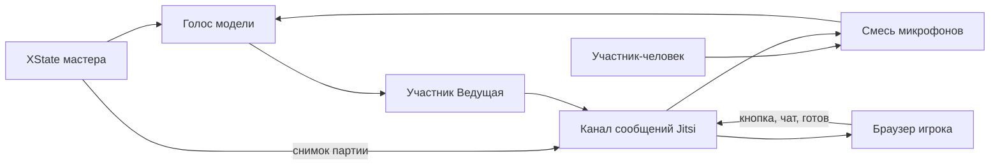

# Онлайн-режим через Jitsi

Код конференции ещё не написан. Это договорённость, по которой его будем делать. Сервер Jitsi поднимается отдельно: [JITSI.md](JITSI.md). Когда режим будет в игре, этот файл можно удалить.

Режим «За столом» не меняется: один браузер, одна машина XState, микрофон комнаты, те же e2e. Конференция — отдельная ветка до `START_GAME` и отдельная отрисовка для тех, кто зашёл по ссылке.

## Как это устроено

Мастер — браузер, который создал комнату. Он один вводит ключ модели, один запускает ведущую и один крутит [src/game/machine.ts](../src/game/machine.ts). Остальные браузеры машину не запускают: жмут кнопку, пишут в чат и рисуют снимок, который прислал мастер.

В комнате Jitsi у мастера два участника. Человек — с именем игрока, микрофоном и камерой. «Ведущая» — второе подключение того же браузера, только звук модели. Своё аудио «Ведущей» мастер не проигрывает из конференции: он и так слышит его локально. В смесь для модели дорожка «Ведущей» не входит, иначе она услышит сама себя.

Игроки слышат ведущую из конференции. Их микрофоны мастер смешивает и отдаёт модели только в те фазы, где контроллер и сейчас включает микрофон. Выключенный микрофон конференции значит, что этого человека не слышат ни игроки, ни модель.

## Старт

Карточка [src/ui/StartScreen.tsx](../src/ui/StartScreen.tsx) сейчас `min(520px)`. Делаем шире, около 960px, два столбца. Слева пакет и имена, справа модель и ключ. Прямо над кнопками переключатель:

- **За столом** — как сейчас, поле всех имён.
- **Конференция** — одно поле «Ваше имя». Адрес Jitsi виден только здесь. По умолчанию `https://fallout-nevada.ru/jitsi`, без слэша в конце. Это публичный путь за nginx, не адрес контейнера.

Подписи «Пакет вопросов», «Имена игроков», «Модель», «Ключ …» остаются в том же порядке в DOM, чтобы тест порядка полей в [e2e/match.play.ts](../e2e/match.play.ts) не разъехался. Переключатель и адрес Jitsi стоят после них.

«За столом» по-прежнему зовёт `START_GAME` и ничего не знает про Jitsi. Библиотеку конференции подгружаем только в режиме конференции.

## Подключение к серверу

Поле — базовый URL пути `/jitsi`, не готовый websocket и не порт контейнера. Для `https://fallout-nevada.ru/jitsi` клиент сам собирает:

- `https://fallout-nevada.ru/jitsi/config.js`
- `https://fallout-nevada.ru/jitsi/libs/lib-jitsi-meet.min.js`
- `wss://fallout-nevada.ru/jitsi/xmpp-websocket`

Если в поле схема `http`, websocket будет `ws`. Рабочий сервер — `https`, потому что TLS заканчивается на nginx.

`config.js` читаем как текст и не исполняем. Оттуда берём только `config.hosts.domain`: в docker-jitsi это внутреннее имя `meet.jitsi`, не публичный хост. `hosts.muc` берём, только если в файле это готовая строка в кавычках; иначе `muc.` плюс domain. `hosts.focus` так же, иначе `focus.` плюс domain. Адрес websocket из `config.js` не используем: при поддоменах шаблон склеивает его в JavaScript, а путь должен совпасть с полем и с `location` nginx.

Библиотеку грузим скриптом с `{база}/libs/lib-jitsi-meet.min.js`, чтобы она совпала с сервером, а не из npm.

Пока сервер из [docs/JITSI.md](JITSI.md) не поднят, `{база}/config.js` отвечает 404. Тогда на экране ошибка, партия не стартует. Режим «За столом» от этого не зависит.

В конференции `p2p` выключен, канал моста открыт: служебные сообщения не должны пропадать, когда в комнате двое. Комната Jitsi называется UUID партии.

## Сервер

Запуск Docker и nginx вынесен в [docs/JITSI.md](JITSI.md). Здесь остаётся только адрес, который вводит мастер: `https://fallout-nevada.ru/jitsi`.

## Ссылка и кто есть кто

Мастер один раз делает `crypto.randomUUID()` комнаты и свой `clientId`. Ссылка — полный адрес приложения, не голый origin. База берётся из `location.origin` и `import.meta.env.BASE_URL`, как пакеты в [src/game/catalog.ts](../src/game/catalog.ts). В сборке Vite `base` равен `/aisigame/`, в `npm run dev` — `/`. Текущие `?mock=1` и прочие параметры в ссылку не копируются.

На GitHub Pages получается `https://roginvs.github.io/aisigame/?join={uuid комнаты}&jitsi={базовый URL}`. Локально — `http://127.0.0.1:5173/?join=…&jitsi=…`. Без `/aisigame/` страница Pages не откроет игру.

Кнопка «Скопировать ссылку» в лобби и в шапке партии. По ссылке человек не становится мастером. Параметры `join` и `jitsi` читаются с адреса, на котором открыто приложение, уже с учётом этого пути.

Переход по ссылке сам ничего не открывает. В адресе лежит чужой адрес Jitsi, и с него ещё грузится скрипт библиотеки, поэтому до нажатия кнопки нет ни websocket, ни загрузки скрипта, ни микрофона, ни скачивания пакета. На экране подтверждение: куда ведёт ссылка (хост из параметра `jitsi`), поле «Ваше имя» — уже подставлено, если оно сохранено, — и две кнопки. «Подключиться» запоминает имя и только тогда входит в комнату. «Не входить» оставляет обычное меню, параметры приглашения больше не действуют. То же подтверждение при каждой загрузке страницы со ссылкой, в том числе после обновления: прошлый вход его не отменяет. Сохранение мастера при отказе не стирается. Если в этом браузере сохранена та же комната и роль мастера, после «Подключиться» он входит мастером, а не игроком.

`clientId` лежит в `localStorage` (`aisigame.clientId`) и не меняется. Имя конференции — отдельно от списка имён режима «За столом». Числовой `id` игрока, как сейчас в [src/game/types.ts](../src/game/types.ts), выдаёт мастер при первом hello и больше не переиспользует. В `Player` добавляется необязательный `clientId`. В режиме «За столом» его нет.

Мастер — первый игрок. Пока он один, выбирает он сам. Когда игроков двое и больше, первый выбор темы по-прежнему у второго.

## Лобби

После «Начать игру» в конференции мастер ещё не шлёт `START_GAME`. Он входит в комнату, подключает модель и ведущую и видит экран партии, где на месте табло список людей.

У каждого: имя, полоска файла, галочка «готов», серый вид, если давно не было сигнала. У мастера на этом месте кнопка «Начать игру». У остальных — «Я готов», она не нажимается, пока игрок сам не сверил sha256 полученных байтов с хешем, который прислал мастер.

Если кто-то ещё качает, хеш не сошёлся или игрок не нажал «готов», мастер видит обычный `confirm`: начать можно, потому что люди могут зайти посреди партии. После старта «Я готов» больше не нужна. Пока хеш пакета не сошёлся, нажатия кнопки этого игрока мастер выбрасывает.

Кто подтвердил вход раньше мастера, видит на табло «Ждём мастер-игрока». Hello уходит с именем с экрана подтверждения.

Кто зашёл посреди партии, качает файл с процентами. Играть он начинает только после обязательной проверки хеша: мастер добавляет его событием `ADD_PLAYER`, счёт с нуля, числовой id новый. До совпадения хеша кнопка не действует.

Сигнал раз в 3 секунды. 10 секунд тишины — игрок серый, это уходит всем в снимке. Минута тишины — пропадает с табло, но мастер помнит `clientId` и счёт. Тот же id после перезагрузки возвращает того же игрока и тот же счёт. Если 10 секунд нет мастера, на табло «Мастер-игрок отключился». Перехватывать роль мастера нельзя.

### Что говорит ведущая в лобби

Пока партия ещё не началась, ведущая вслух ведёт комнату. Фразы не зашиваем списком: контроллер отдаёт модели короткие факты о лобби, а она сама решает, что сейчас уместно сказать — живо, коротко, без лишней болтовни и без тишины на каждом важном шаге. Тон тот же, что в партии: тёплый, чуть кокетливый.

Когда мастер только вошёл и модель уже подключена, она объявляет, что игра создана, называет пакет и коротко рассказывает, что в нём известно из разбора `.siq`: сколько раундов, есть ли финал, сколько тем или вопросов, если это видно без лишнего. Не перечисляет темы и номиналы целиком — они на табло после старта. В конце той же реплики или сразу следом — что ждём игроков.

Дальше модель получает смену состава и статусов: кто подключился, кто скачал пакет и сверил хеш, кто нажал «готов», что все готовы или почти все, что кто-то отвалился или снова появился. Она может назвать имя сразу («о, к нам Вася») или собрать несколько событий в одну короткую сводку, если они пришли кучей. На каждое мелкое обновление полоски скачивания не отвечает. Процент загрузки вслух не читает, кроме редкого случая, когда это уместно по смыслу («ещё качает»). Когда все, кто в комнате, готовы — говорит об этом по-человечески и не зовёт начинать сама: кнопку «Начать игру» жмёт мастер.

Инструкция хода лобби явно отдаёт модели право молчать, если с прошлого раза ничего существенного не случилось, и право суммировать, если накопилось. Готовых шаблонов «скажи ровно эту фразу» в коде нет: только факты и тон. Реплики лобби, как и остальные, слышат все через дорожку «Ведущей» в Jitsi и пишутся в колонку «Разговор» снимка.

## Файл пакета

И каталог, и свой файл идут кусками через `sendEndpointMessage` / `broadcastEndpointMessage`. В снимок партии байты не кладём: в `localStorage` архив до 99 МБ не влезает. Байты мастера и уже проверенный файл игрока лежат в IndexedDB. Ключ записи — sha256 тех же байтов.

Мастер в начале передачи присылает hex-хеш исходного файла. Это тот же `sha256Hex` из [src/game/savedGame.ts](../src/game/savedGame.ts), что уже пишется в снимок своего пакета. Игрок обязан посчитать sha256 собранных байтов и сравнить с присланным. Пока они не равны, файл не разбирается, в IndexedDB как готовый не пишется, «Я готов» выключена, кнопку мастер не принимает. На карточке игрока при этом ошибка сверки, и он просит куски заново.

Куски около 16 КБ, несколько штук в полёте, подтверждение непрерывного префикса, потерянные куски шлём снова. Процент — у всех на карточках игроков, обновление полоски не чаще нескольких раз в секунду. Сто процентов означают, что байты собраны и хеш совпал, а не только что пришёл последний кусок. Архив на 99 МБ будет качаться заметно долго; полоска это показывает, канал моста при этом не забиваем пачкой без окна.

Повторный заход не верит подписи в базе. Игрок заново считает хеш лежащих байтов и берёт их только если он равен хешу, который мастер прислал в этот раз. Иначе качает заново.

Игрок разбирает `.siq` у себя только после совпадения хеша. В снимке только id вопросов, не blob-адреса. Картинка, звук и ролик вопроса играют локально из своего файла, в конференцию их не гоним.

Продолжение конференции: мастер поднимает ту же комнату и тот же URL. Свой файл берёт из IndexedDB, а не спрашивает заново. Режим «За столом» по-прежнему просит выбрать свой файл руками.

## Снимок, который видят игроки

Мастер шлёт не весь контекст машины, а снимок: фаза, игроки и счёт, `clientId`, присутствие и проценты, сыгранные клетки, id активного вопроса, кто выбирает, кто отвечает, фальстарты, ставки финала, остаток таймера, реплики колонки «Разговор», текстовый чат.

Реплики «Разговор» сейчас живут только в памяти [src/debug/trace.ts](../src/debug/trace.ts) (`pushHostLine`, `pushPlayerLine`, `pushJudgeLine`). В конференции мастер добавляет их в снимок. Чат — отдельные строки с именем, не «Услышано». Храним последние 200. Чат и снимок конференции пишутся в сохранение мастера. Старый снимок без поля режима читается как «За столом».

Нажатия игрока — сообщения `buzz` и `pick`. Мастер сам решает фальстарт и принимает выбор клетки только от того, кто сейчас выбирает, и только в фазе выбора. Голос выбора и ставки финала по-прежнему разбирает модель: она слышит смесь микрофонов.

На устройстве игрока своя кнопка и пробел. Чужие кнопки видны, но с этого устройства не жмутся. Левый Ctrl, пробел и правый Ctrl для троих остаются только в режиме «За столом». Сигнал за две секунды до конца окна каждый браузер играет сам по остатку таймера из снимка.

Пауза, пропуск раунда и выход из партии — у мастера. У игрока в шапке выход со стола: он покидает комнату и возвращается в меню, сохранение мастера не стирает.

## Звук модели

[src/realtime/voice.ts](../src/realtime/voice.ts) и контроллер снаружи те же. Два необязательных крючка, которые режим «За столом» не вызывает:

- отдать `MediaStream` уже играющей ведущей;
- подменить микрофон модели готовой смесью.

OpenAI уже имеет поток в `ontrack`. Grok и Gemini играют через `PcmPlayer` в [src/realtime/pcm.ts](../src/realtime/pcm.ts): для конференции тот же звук дополнительно выводится в `MediaStreamAudioDestinationNode`. Запасное чтение через `speechSynthesis` в поток не попадает — его слышит только мастер. Это редкий путь, когда модель прочитала не тот вопрос.

Дорожку ведущей кладём в Jitsi через `JitsiMeetJS.createLocalTracksFromMediaStreams`: в потоке ровно одна аудиодорожка.

Микрофон панели: первое включение спрашивает разрешение, следующее выключение только глушит дорожку. Камера выключается и дорожку отпускает. Чужая плитка показывает имя, перечёркнутый микрофон и вспышку, когда человек говорит. Свой технический лог на экран не возвращаем: видео — третья колонка справа от «Разговора». Узкий экран складывает её в полоску. В режиме «За столом» колонки две, как сейчас.

Текстовый чат — поле внизу колонки «Разговор». Это наши сообщения по каналу Jitsi, не чат Jitsi.

## Тесты

- Vitest: нарезка и сборка файла, окно и повтор куска, обязательная сверка sha256. Совпавший хеш разрешает разбор. Чужой байт или оборванный хвост оставляет игрока без пакета: «Я готов» и кнопка закрыты, в IndexedDB готовой записи нет. Отдельно: серый через 10 секунд и скрытие через минуту, разбор ссылки с путём `/aisigame/` и без него, старый снимок без режима по-прежнему «За столом».
- Playwright: два окна и мост на `BroadcastChannel`, без настоящего Jitsi и без ключа. Мастер создаёт комнату, игрок открывает ссылку и до «Подключиться» не входит в комнату. После подтверждения и имени файл доезжает на заглушке, игрок сверяет хеш и только потом жмёт «готов», мастер начинает, игрок видит табло, его кнопка меняет счёт у мастера. «Не входить» оставляет меню. Отдельный шаг: подменённый кусок не даёт нажать «Я готов».
- Уже существующие `e2e/match.play.ts`, `layout.play.ts` и `resume.play.ts` остаются на режиме «За столом».

## Куда класть код, когда будем делать

- `src/conference/` — чтение `config.js`, комната, протокол, нарезка файла, присутствие, звуковой мост, мост для тестов.
- [src/game/machine.ts](../src/game/machine.ts) — только `ADD_PLAYER` и `clientId`. Остальные правила те же.
- [src/game/savedGame.ts](../src/game/savedGame.ts) — режим, URL, uuid комнаты, чат, id клиентов. Ключ модели в снимок не пишется.
- [src/ui/GameScreen.tsx](../src/ui/GameScreen.tsx) — лобби на месте табло, третья колонка, поле чата, своя кнопка.
- [docs/STATES.md](STATES.md) и [docs/CONTEXT.md](CONTEXT.md) — когда появится `ADD_PLAYER` и лобби. [AGENTS.md](../AGENTS.md) — коротко, что конференция описана в `docs/ONLINE.md`, а сервер в `docs/JITSI.md`.
